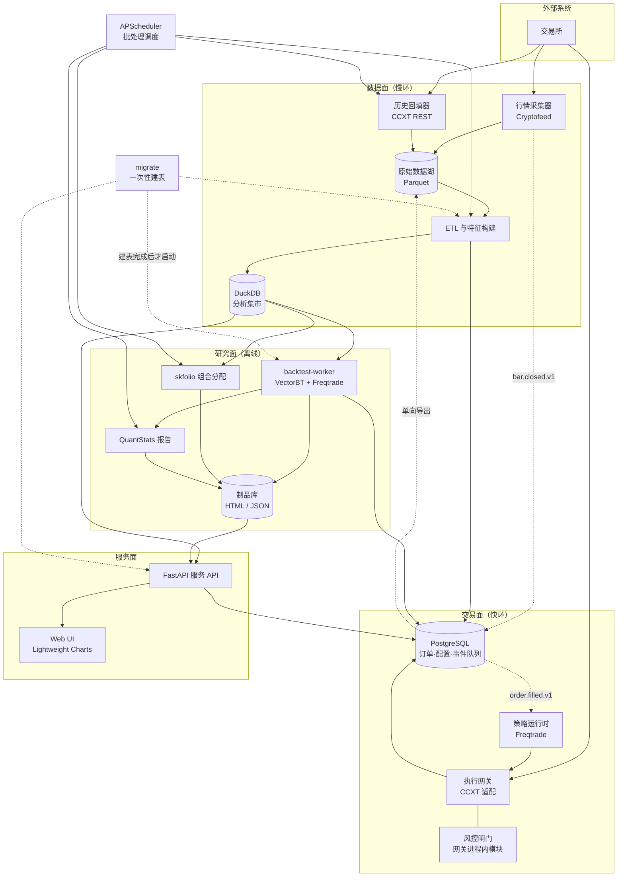
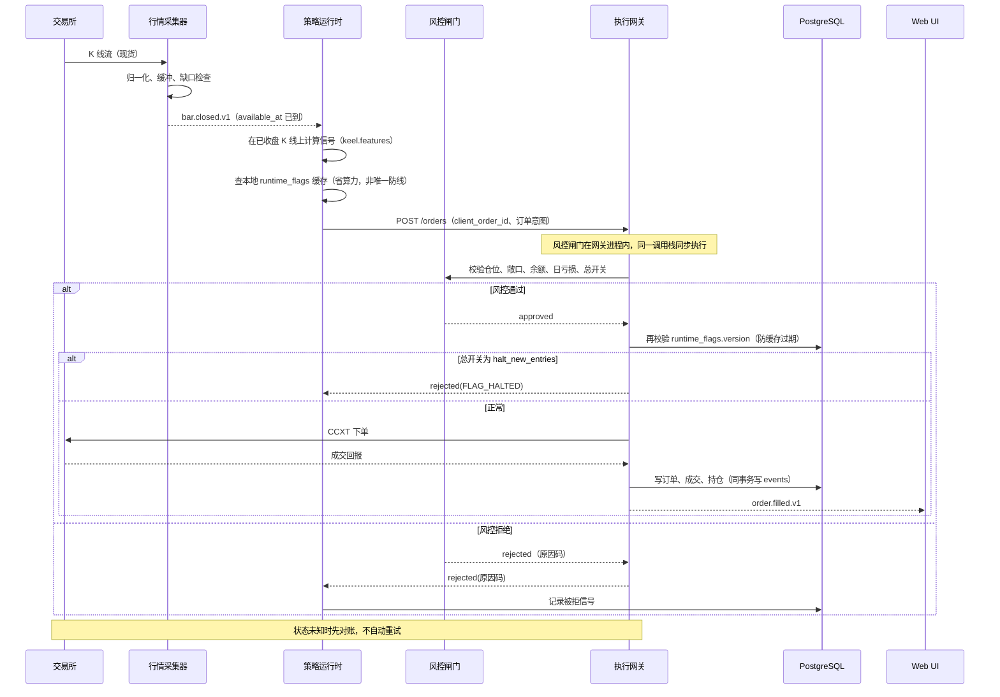
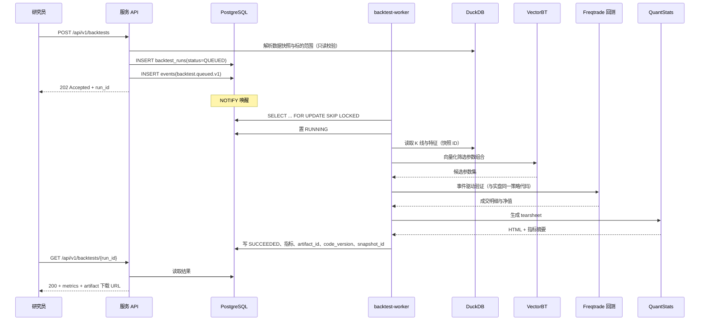
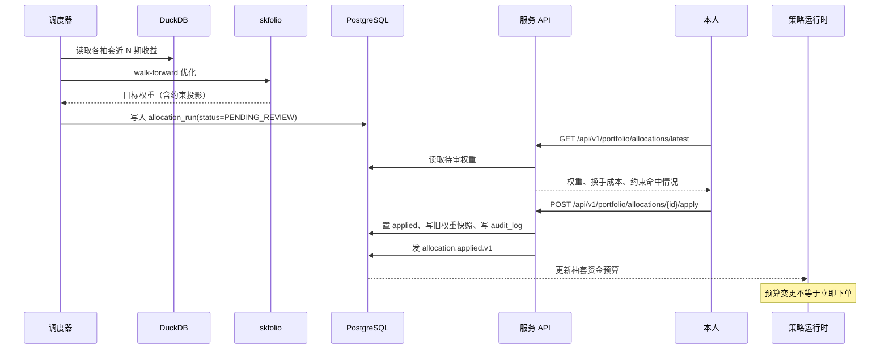
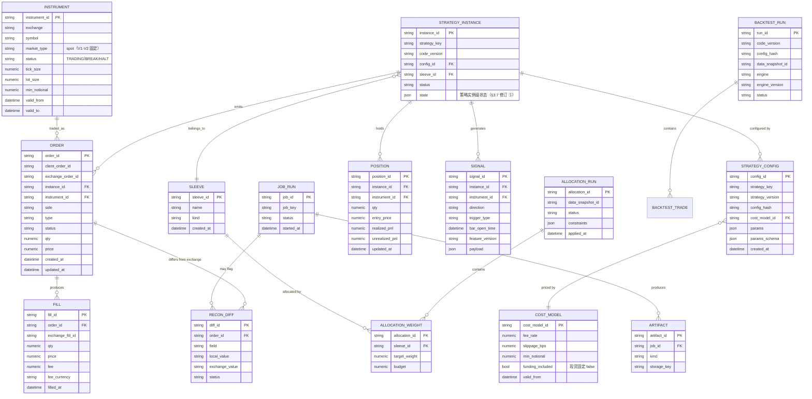
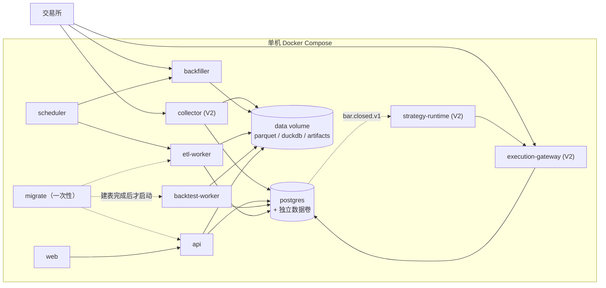
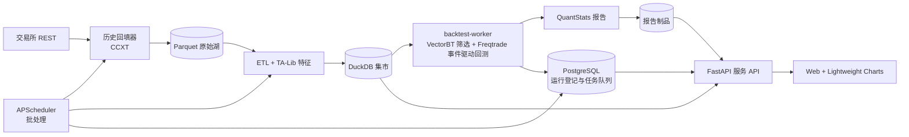
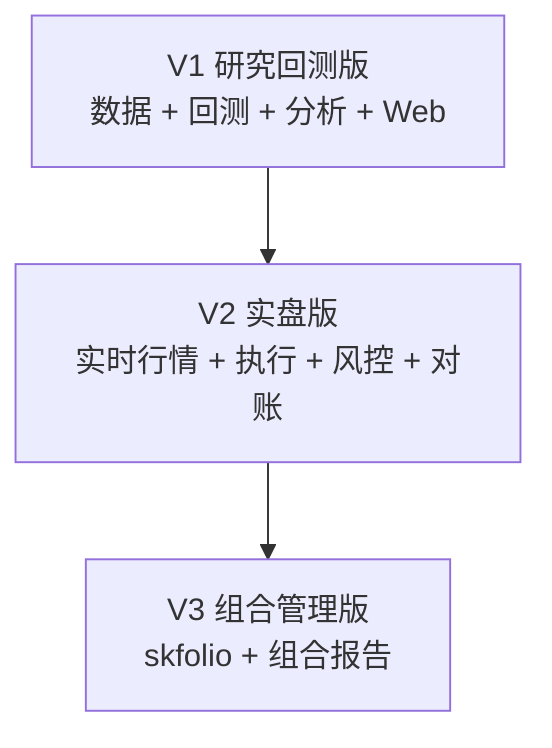

# Keel（龙骨）个人加密量化平台技术架构设计

> 项目名：Keel（龙骨）。名字取自船体最先铺设的龙骨，对应平台最先铺设的数据与回测底座。
> 文档类型：技术架构设计（概要设计为主，含关键模块详细设计与数据/接口设计）
> 系统阶段：全新系统（Greenfield），无既有代码与既有数据
> 使用者：本人（开发、研究、交易与运维均由一人承担）
> 上游输入：口头需求（九组件链路），无 PRD
> 版本：2026-11-05 / v0.9
> 当前交付目标：V1 研究回测版（历史数据、回测、报告与查看），交易执行从 V2 开始

---

## 0. 设计前提

### 0.1 需求识别

| 维度 | 判断 | 依据 |
|---|---|---|
| 文档类型 | 技术架构 + 关键模块 LLD + 数据设计 + 接口设计 | 用户要求「技术文档」，且给出完整组件链路 |
| 系统阶段 | Greenfield | 用户明确要求不以现有项目为基础 |
| 读者 | 本人 | 开发、研究、交易与运维由一人承担 |
| 复杂度 | Medium | 覆盖数据、研究、回测、执行、报告与展示，但只服务单用户 |
| 上游制品 | 仅口头组件清单 | 无 PRD、无容量指标、无既定规模 |

因为没有 PRD，下面把需求假设逐条列出。每条都标 `[Hypothesis]`，实施前需要本人确认或推翻；确认前不应当作既定事实进入排期。

### 0.2 需求假设

| 编号 | 假设 | 影响 |
|---|---|---|
| H1 | 个人自用，单用户、单机，不做多用户与权限分层 | 不需要账号体系、角色分层、审批与操作人记录 |
| H2 | 只接入 1 家交易所（Binance），V1–V2 只做现货，永续延后至 V3 | 适配范围收窄为一所一市场；交易对主数据不含保证金与杠杆档位；成本模型只有手续费 + 滑点；`ods_funding` 等衍生字段延后 |
| H3 | 标的规模 10–50 个，以 1h/4h/1d 为主，按需补 1m | 存储量与回填成本可控 |
| H4 | 资金规模与交易频率不构成高频场景，分钟级响应足够 | 不需要托管、专线、低延迟撮合 |
| H5 | 单机 Docker Compose 部署，不拆多节点 | 调度与数据库保持单实例 |
| H6 | 单人开发与使用，没有运维值班 | 架构优先降低运维与恢复成本，不追求高可用 |
| H7 | 以研究与回测为主，实盘只做小资金验证 | 研究面优先级高于交易面 |
| H8 | 交易所条款允许本地留存与二次计算行情数据（2026-11-05 按 Binance 条款核对，见 ADR-002） | 决定原始数据能否长期落盘 |

H2 的原写法是「覆盖现货与 USDT 本位永续」，属范围过宽，V1/V2 撑不住。收窄理由：永续额外引入三样东西——资金费（采集、结算时点、回测成本项）、保证金与强平（风控要算维持保证金档位，而不是简单的止损距离）、杠杆档位（合约主数据要维护一张随交易所动态调整的表）。三样各有独立复杂度，而其收益（吃资金费、或做空）在小资金验证阶段不成立。现货的成本模型只有手续费与滑点两项，回测与实盘的可比性也因此更容易验证。永续作为 V3 增量重新评估，本文 §3.6、§5.4 中与保证金、资金费相关的段落作为草稿保留但不进入 V1–V2 交付。

**这个决策的代价要说清楚**：现货不能做空，意味着策略库只剩「多头 / 空仓」两态，趋势策略的回撤控制会明显弱于能双向做的系统。这是有意换来的：先把「数据 → 特征 → 回测 → 报告」这条链路用最简单的市场跑通，比一上来就同时对付强平与结算要划算。真正需要做空时，再按 V3 增量补。

### 0.3 非目标

以下内容明确不在本期设计范围内：

- 跨交易所搬砖、做市、延迟套利等对网络与撮合延迟敏感的策略。
- 对外服务、多用户共享、跟单与资金托管。
- 第二家交易所接入。
- 逐笔成交与盘口数据的采集与留存。
- 移动端原生 App。
- 自研撮合引擎或自研交易所接入协议。
- 机器学习模型训练平台（本期只预留特征与样本接口）。

### 0.4 证据标签

本文默认所有设计选择属于工程判断 `[Expert judgment]`；只有需要区分时显式标注：

- `[Hypothesis]`：填补信息缺口的假设，实施前必须确认。
- `[Data-backed]`：来自用户给定条件或可复算的数据。
- `[Research-backed]`：有外部标准或公开资料支撑，且能给出可核对的来源（文档名、版本、链接）。
- `[待确认]`：版本、接口覆盖度、许可证条款等事实，实施前逐项核对。

使用纪律：涉及第三方行为（交易所限流、数据库并发模型、库的默认参数）的论断，本文按公开文档的通行描述给出，但没有逐条附链接，一律按 `[Expert judgment]` 记，实施前以 `[待确认]` 核对。宁可标低，不把未核对的说法包装成 `[Research-backed]`。

---

## 1. 设计目标与约束

### 1.1 功能目标

| 编号 | 目标 | 验收口径 |
|---|---|---|
| FR-01 | 采集并留存交易所行情 | 指定标的历史 K 线可回放，缺口可枚举 |
| FR-02 | 用统一接口下单与查询持仓 | 一套调用覆盖该交易所的现货下单、撤单、查询与成交回报（永续在 V3） |
| FR-03 | 运行策略并管理订单生命周期 | 信号、订单、成交、持仓可逐笔追溯 |
| FR-04 | 离线回测与指标计算 | 同一策略配置可产出可复现的回测结果 |
| FR-05 | 组合层资金分配 | 输出可解释的目标权重与资金预算 |
| FR-06 | 定期生成业绩报告 | 周报/月报可从指定数据快照重算 |
| FR-07 | 定时执行批处理任务 | 任务有执行记录、可重跑、幂等 |
| FR-08 | Web 端查看行情、回测、持仓与报告 | 图表加载与交互满足第 7 节时延指标 |

### 1.2 非功能约束

| 类别 | 约束 | 来源 |
|---|---|---|
| 时延 | 收盘 K 线在收盘后 10 秒内可被策略消费；信号到下单 p95 小于 2 秒 | `[Hypothesis]` |
| 可用性 | 交易面运行期间可用，进程崩溃后能恢复并完成对账；不设月度可用性目标 | `[Hypothesis]` |
| 一致性 | 订单与持仓以交易所为真源，本地状态允许短暂滞后，但必须能对账收敛 | `[Expert judgment]` |
| 可复现 | 任何回测与报告必须绑定代码版本、配置哈希、数据快照 | `[Expert judgment]` |
| 安全 | 交易密钥不出现在代码库、数据库明文字段与日志中 | `[Expert judgment]` |
| 成本 | 首期单机即可运行，不引入托管数据库与分布式调度 | `[Hypothesis]` |
| 许可 | 引入 GPL 组件时，与自有代码保持进程边界；当前不分发，故分发义务不触发 | `[Expert judgment]` / `[待确认：Q3]` |
| 可运维 | 单人可维护：任一组件故障有告警，恢复不依赖记忆中的手工步骤，恢复路径写入 runbook | `[Hypothesis]` |

### 1.3 组件到模块的映射

| 原链路组件 | 在本设计中的落点 | 承担职责 | 引入版本 |
|---|---|---|---|
| Cryptofeed | 行情采集器 | 实时 K 线归一化（资金费与持仓量在现货范围外，V3 再评估） | V2 |
| CCXT | 历史回填器 + 执行网关 | V1 只回填历史与现货交易对主数据；V2 起承担下单与查询 | V1 只读，V2 交易 |
| Freqtrade | 回测引擎 + 策略运行时 | V1 由 `backtest-worker` 以命令行回测；V2 转为常驻运行时 | V1 回测，V2 实盘 |
| VectorBT + TA-Lib | 研究实验室 | 因子筛选、参数扫描、指标计算 | V1 |
| skfolio | 组合分配器 | 策略袖套层面的资金权重 | V3 |
| QuantStats | 报告服务 | V1 产出研究回测报告；V3 增加组合报告 | V1，V3 扩展 |
| DuckDB | 分析数据平台 | Parquet 之上的查询与建模引擎 | V1 |
| APScheduler | 运维调度器 | V1 只跑批处理；V2 增加交易运维任务 | V1 |
| Lightweight Charts | Web 展示层 | 行情、成交标记、净值与回撤图 | V1 |

### 1.4 目标到模块的对应

| 功能目标 | 承担模块 | 首版交付 |
|---|---|---|
| FR-01 行情留存 | 行情采集器、历史回填器、数据平台 | V1 历史数据，V2 实时数据 |
| FR-02 统一交易接口 | 执行网关 | V2 |
| FR-03 策略与订单生命周期 | 策略运行时、风控闸门、执行网关 | V2 |
| FR-04 离线回测 | 研究实验室、数据平台 | V1 |
| FR-05 组合资金分配 | 组合分配器 | V3 |
| FR-06 业绩报告 | 报告服务 | V1 研究回测报告，V3 组合报告 |
| FR-07 定时批处理 | 运维调度器 | V1 |
| FR-08 Web 查询与图表 | 服务 API、Web UI | V1 |

### 1.5 版本划分

| 版本 | 主题 | 主要能力 | 不包含 | 状态 |
|---|---|---|---|---|
| V1 | 研究回测版 | 历史数据湖、TA-Lib 特征、VectorBT 筛选、Freqtrade 回测、QuantStats 报告、行情与回测查看 | 实时行情、下单、组合优化 | 当前目标 |
| V2 | 实盘版 | 实时采集、策略运行时、执行网关、风控、对账、总开关 | 组合优化 | 待 V1 验收 |
| V3 | 组合管理版 | skfolio 分配、组合报告 | 无 | 待 V2 验收 |

V1 的模块、数据表、接口与验收标准集中在 §11.1。后续版本只描述相对上一版的增量，总体设计不再重复。

---

## 2. 架构总览

### 2.1 架构风格

采用「模块化单体 + 两个隔离运行时 + 分析旁路」的结构：

- 交易面是一个独立进程组，包含策略运行时、执行网关、风控，负责秒级到分钟级的快环。
- 数据面是一个独立进程组，包含采集、回填、ETL，负责批处理与慢环。
- 研究面是离线环境，只读数据湖，产出报告与参数建议，不持有交易权限。
- 服务面是服务 API 与 Web，只做查询与「入队/开关/生效」这类控制操作，不参与交易决策、不直接下单。注意它并非全只读：API-03/07/09/14 会写 PostgreSQL 的控制面与任务队列（§3.11）。

选择这个结构的原因是一人使用、单机部署 `[Hypothesis]`。拆成微服务会带来服务发现、链路追踪、分布式事务的运维成本，而本系统的主要风险来自数据正确性与交易一致性，不来自横向扩展。等数据面吞吐成为瓶颈时，再把采集与 ETL 拆出去，边界已经按进程划好，拆分成本可控 `[Expert judgment]`。

### 2.2 系统架构图



图中实线是调用或写入，虚线是事件或数据流向。`COL -.-> PG` 表示采集器把 `bar.closed.v1` 写入事件表；`PG -.-> SR` 表示策略运行时从事件表消费。风控闸门用 `GW --- RISK`（无箭头）表示它是网关的内部模块，不是独立节点。

架构图的读法：

- 交易所同时向采集器和回填器提供数据，向执行网关提供交易接口。三者共用一套交易对主数据（`instruments`），互不互相调用。
- 原始数据湖是行情与成交历史的唯一留存层，只追加。ETL 从原始层构建分析集市，DuckDB 在集市之上提供查询。
- 研究面从 DuckDB 读取数据，产出报告与参数建议；它没有交易所密钥，也不写订单库。研究面的所有回测计算都在 `backtest-worker` 里，不在 API 进程内。
- 交易面通过执行网关与交易所交互，订单与持仓落在 PostgreSQL。PostgreSQL 的事实以单向导出方式进入数据湖，供研究使用。
- **两个面之间只通过 PostgreSQL 通信**，没有别的连接：数据面往 `events` 写，交易面从 `events` 读；交易面往业务表写，`export-tx` 往外导。这条边界让「研究面误碰交易状态」和「交易面误读半成品集市」都变成不可能，而不是靠自觉 `[Expert judgment]`。
- APScheduler 只触发批处理任务，不参与行情收盘事件与下单时序，也不触发回测（回测由 API 入队，§2.5.6）。

### 2.3 组件职责与边界

| 组件 | 拥有的职责 | 明确不负责 | 依赖 |
|---|---|---|---|
| 行情采集器 | 实时流连接、符号归一、缓冲落盘、缺口标记 | 策略计算、下单、订单状态 | 交易所 WS、原始数据湖 |
| 历史回填器 | 历史 K 线回补、现货交易对主数据同步 | 实时流处理、交易 | Binance REST、原始数据湖 |
| ETL 与特征 | 清洗、对齐、特征计算、集市构建 | 策略决策、订单执行 | 原始数据湖、DuckDB |
| 策略运行时 | 策略评估、信号生成、订单意图 | 交易所鉴权细节、资金划转 | PostgreSQL（事件与配置）、执行网关 |
| 风控闸门 | 仓位上限、敞口上限、日亏损熔断、总开关 | 策略逻辑、订单路由、异步事件消费 | 配置库、持仓快照（网关进程内，§3.6） |
| 执行网关 | 下单、撤单、查询、成交回报、对账 | 策略判断、仓位计算 | 交易所 API、PostgreSQL |
| 研究实验室 | 因子研究、参数扫描、回测（由 `backtest-worker` 执行） | 实盘下单、生产数据写入 | DuckDB、制品库、PostgreSQL 任务队列 |
| 组合分配器 | 目标权重、资金预算、换手约束 | 单笔订单、止损管理 | 收益序列、配置库 |
| 报告服务 | 净值报告、指标汇总、制品生成 | 交易决策、订单查询 | 制品库、DuckDB |
| 运维调度器 | 批处理触发、任务记录、失败重试 | 交易时序、行情事件、回测执行 | 任务库、各批处理模块 |
| 服务 API | 查询行情、回测、持仓、报告；入队回测、开关新开仓、生效分配、撤单 | 写入交易状态本身、直接下单、重计算指标 | DuckDB、制品库、PostgreSQL |
| Web UI | 图表渲染、查询交互 | 指标计算、策略执行 | 服务 API |

### 2.4 原链路的落地方式

原链路是一条单向箭头序列。在本设计中，箭头被重新解释为「共享数据」与「调用关系」两类：

| 原箭头 | 落地方式 |
|---|---|
| Cryptofeed → CCXT | 不直连。两者各自连接交易所，共享交易对主数据 |
| CCXT → Freqtrade | 不直连。Freqtrade 经执行网关使用 CCXT，历史数据由回填器提供 |
| Freqtrade → VectorBT | 不直连。策略代码是实盘真源，VectorBT 只做可向量化的前置筛选 |
| VectorBT → skfolio | 通过「周期收益矩阵」衔接，成交明细先聚合成策略/标的收益序列 |
| skfolio → QuantStats | 通过「组合净值序列」衔接，权重合成组合收益后再出报告 |
| QuantStats → DuckDB | 方向修正。报告制品写入制品库，元数据登记进 DuckDB，正文不回写 |
| DuckDB → APScheduler | 方向修正。调度器触发任务，任务读取 DuckDB |
| APScheduler → Lightweight Charts | 不直连。图表读服务 API，API 读 DuckDB 与制品库 |

这个映射保留九组件的全部能力，同时把「谁触发谁」和「谁共享什么」分开。按字面串联会让调度器、数据库、图表互相伪装成上下游，排查问题时无法判断事实来自哪一层 `[Expert judgment]`。

### 2.5 运行时、通信与控制面

上一版的架构图只画了「谁连谁」，没有画「线怎么走」。这一节补的是容器之间的连接件：事件怎么传、回测谁来跑、实盘特征在哪算、总开关怎么生效、告警发到哪。这些是单人项目最容易烂尾的地方，必须先定死再写代码。

#### 2.5.1 进程清单

| 容器 | V1 | V2 | 形态 | 说明 |
|---|---|---|---|---|
| `backfiller` | 启用 | 启用 | 定时任务（容器常驻，被调度触发） | CCXT REST 回填 |
| `etl-worker` | 启用 | 启用 | 常驻，消费 ETL 任务 | Parquet → DuckDB 集市 |
| `backtest-worker` | 启用 | 启用 | 常驻，消费回测任务 | 新增，见 2.5.6 |
| ~~`redis`~~ | — | — | — | 不引入。事件通道用 PG（§2.5.2），缓存用进程内 LRU |
| `scheduler` | 启用 | 启用 | 常驻 | APScheduler，只触发批处理 |
| `api` | 启用 | 启用 | 常驻 | 服务 API |
| `web` | 启用 | 启用 | 常驻 | 静态资源 + 反向代理 |
| `collector` | 不启用 | 启用 | 常驻 | Cryptofeed WS |
| `strategy-runtime` | 不启用 | 启用 | 常驻 | Freqtrade |
| `execution-gateway` | 不启用 | 启用 | 常驻 | CCXT 下单与对账；**风控闸门是其进程内模块**，不单独成容器 |
| `postgres` | 启用 | 启用 | 常驻 | 状态库 + 事件队列，见 2.5.2 |

`backtest-worker` 与 `etl-worker` 分开，原因是回测会吃满 CPU 与内存，和 ETL 共用容器会让每日批处理被回测挤死 `[Expert judgment]`。两者都限制 CPU/内存配额。

**风控闸门为什么不独立部署**：它必须是同步调用（§6.4），独立容器会引入一次网络往返与一个新的故障点，而它校验的是内存中的持仓快照与配置缓存——放在网关进程内，既能同步调用，又能在网关拿到最新持仓后立刻校验 `[Expert judgment]`。代价是网关进程变重，但它本来就不做计算密集的事。图中把「风控闸门」画成独立方框是为了表达职责边界，不是说它是独立进程。

#### 2.5.2 事件通道选型

结论：**不引入独立消息中间件。事件走 PostgreSQL 表 + `LISTEN/NOTIFY` 唤醒。**

原因有三条：

1. 事件量极小。1h 周期、50 标的，`bar.closed.v1` 每小时最多 50 条；即使全部降到 1m，也只有每小时 3000 条。这个量级不需要 Kafka 或 NATS `[Data-backed：按 H3 的标的数与周期推算]`。
2. 订单状态已经在 PostgreSQL。事件与订单状态同库，可以用同一个事务写入，天然避免「订单写了、事件丢了」的两阶段问题 `[Expert judgment]`。
3. 少一个常驻组件就少一份运维。单人系统里，Redis/NATS 的可用性、持久化、监控都要自己兜。

实现方式：

- 表 `events(seq bigserial, event_id uuid unique, topic, partition_key, payload jsonb, created_at, available_at)`。`seq` 是单调递增的消费水位，`event_id` 是对外的幂等键。**不能拿 uuid 当水位**——uuid 没有序关系，`WHERE event_id > last_event_id` 这种写法在 uuid 类型上等于随机筛选 `[Expert judgment]`（上一版就是这种写法）。按 `created_at` 建索引，按天分区或定期归档。
- 生产方在业务事务内 `INSERT`，事务提交后 `NOTIFY keel_events, '<partition_key>'`。`NOTIFY` 只是唤醒信号，丢了不影响正确性，消费者有轮询兜底。
- 消费者维护 `consumer_offsets(consumer, topic, last_seq, updated_at)`，用 `SELECT ... WHERE seq > last_seq ORDER BY seq LIMIT n` 拉取，处理成功后推进 `last_seq`。
- 去重表 `consumed_events(consumer, event_id, consumed_at)`，主键 `(consumer, event_id)`，保留 30 天；`event_id` 唯一约束在生产者侧防止重复发，去重表防止重复消费。插入冲突即视为重复，直接跳过。
- 分区键用 `symbol`，保证同一标的的事件按序处理；跨标的顺序不做保证，也不需要。
- 唤起失败或消费者重启时，轮询间隔 5 秒兜底；空闲时每秒一次 `LISTEN` 阻塞等待。

**降级路径**：PostgreSQL 不可用时，交易面不允许下单（订单状态无处落）。这是刻意的选择——宁可停，不可写错 `[Expert judgment]`。

**为什么不用 Redis Streams**：Redis 的持久化（AOF/RDB）在掉电时仍可能丢最后一段，而订单相关事件不能丢。若后续事件量增长到 PG 写入成为瓶颈（每秒数千条以上），再换 NATS JetStream，届时只需要替换 `events` 的生产与消费适配层，业务代码不动。

#### 2.5.3 事件契约

沿用 §6.4 的事件清单，补充三条投递语义：

1. **至少一次**。消费者必须幂等，幂等键是 `(consumer, event_id)`。
2. **按分区有序**。同一 `partition_key`（即 symbol）内按 `created_at` 严格递增；跨分区不保证。
3. **可重放**。`events` 保留 30 天，超出后归档到 Parquet（`ods_events`）。回放通过 `SELECT ... WHERE created_at BETWEEN ...` 重新投递到指定的 consumer group，用于故障复盘与补算。

**迟到事件**：`bar.closed.v1` 的 `available_at` 晚于 `close_time`。策略只接受 `available_at <= now` 的事件；迟到事件进入 `late_events` 队列，只用于补算特征与事后复盘，不用于新开仓 `[Expert judgment]`。这条在 §6.4 已有表述，这里明确它的落点是独立队列，不是丢弃。

#### 2.5.4 控制面：总开关与配置传播

总开关（API-09）不能只写接口不写传播，否则 B6 的「10 秒内停止新开仓」无法验证。

设计：

- 状态存在 `runtime_flags(flag_key, value, version, updated_at, updated_by, reason)`，`value` 为 `true/false`，每次变更 `version + 1`。
- 写接口在同一事务内更新 `runtime_flags`、写 `audit_log`、发 `control.changed.v1` 事件。
- 执行网关与策略运行时各维护一个内存缓存，缓存项带 `version`。收到 `NOTIFY` 立即刷新；同时每 2 秒主动比对一次 `version`，防止通知丢失。
- **双重校验**：策略侧检查一次（省掉无效计算），执行网关在真正提交订单前再检查一次（防策略侧缓存过期）。任一处为 `halt_new_entries` 即拒绝新开仓；撤单与平仓路径不受该开关约束 `[Expert judgment]`。
- B6 的验收口径：从 API 返回 202 到网关拒绝下一笔新开仓，p95 小于 10 秒。按 2 秒轮询，最坏 2 秒 + 网关处理时间，指标可达。

同一机制承载其它运行时配置（风控阈值、策略启停、账户切换）。配置变更一律版本化写入，不原地改值。

#### 2.5.5 实盘特征计算路径

这是 V1→V2 最容易返工的地方，必须先定。

结论：**实盘特征在策略进程内用共享特征库现算，不读 DuckDB 的 `dws_features`。**

理由：

1. DuckDB 是单写多读的分析库，让交易面去读它在并发与锁上都不合适，且 ETL 重建集市期间读连接可能拿到半成品 `[Expert judgment]`。
2. 实盘需要的是「最近 N 根 K 线算出的特征」，ETL 产出的 `dws_features` 是批处理结果，天然滞后一个批周期。
3. 回测也必须用同一套计算，否则 A3 的「逐值一致」无从谈起。

落地方式：

- 抽一个独立包 `keel.features`，输入是 `DataFrame[bars]`，输出是 `DataFrame[features]`，无全局状态、无 I/O、无时间依赖（时间由调用方传入）。
- 回测：Freqtrade 回测与 VectorBT 筛选都调用 `keel.features`；ETL 构建 `dws_features` 也调用它。
- 实盘：策略进程内调用同一个函数，输入是采集器落盘后回读的最近窗口（或采集器内存中的窗口），输出即用。
- 一致性校验：ETL 每日对同一窗口重算一次，与实盘进程写出的特征抽样比对，超过 1e-9 相对误差即告警（口径与 A3 一致，避免「实现一致但判定口径不一致」）。这条进 V2 验收（B9）。
- **实盘特征写到哪**：写 PostgreSQL 的 `features_live(instance_id, instrument_id, bar_open_time, feature_version, features jsonb, computed_at)`，不写 DuckDB。原因是 DuckDB 有单写者约束（§3.3，ETL 是唯一写者），让交易面去写会破坏它；而每小时 50 行、每行几百字节的量级，PG 完全扛得住 `[Expert judgment]`。比对任务 `feature-consistency-check` 读 PG 的 `features_live` 与 DuckDB 的 `dws_features` 两侧算差值。

**为什么不在采集器里算特征**：采集器职责是「不丢数据」，加计算会让它的失败面变大；而且研究面无法复用采集器的内存态。

#### 2.5.6 回测执行器

上一版在 §4.2、§3.10、§9、§11.1 四处对「谁跑回测」说法不一。这里统一：

- 新增常驻容器 `backtest-worker`，属于研究实验室的执行侧，不是独立服务，也不对外暴露端口。
- API 的 `POST /api/v1/backtests` 只做三件事：校验参数、写 `backtest_runs(status=QUEUED)`、发 `backtest.queued.v1`。API 不执行回测。
- worker 用 `SELECT ... FOR UPDATE SKIP LOCKED LIMIT 1` 认领任务，置 `RUNNING`，执行完写 `SUCCEEDED/FAILED` 与指标、制品路径。
- 并发度默认 1。回测是内存与 CPU 密集型，单机并行两个以上会互相拖慢，也可能触发 OOM。需要并行时用队列长度换吞吐，不用并发度 `[Expert judgment]`。
- 超时与资源上限：单任务 `timeout=30min`、容器内存上限 8 GB。超时置 `FAILED(TIMEOUT)`，不自动重试（重试大概率再次超时，应先缩范围）。
- 幂等：`Idempotency-Key` 映射到 `run_id`，重复提交返回原任务。
- 崩溃恢复：worker 启动时把 `RUNNING` 超过 2 倍 timeout 的任务置为 `FAILED(ORPHANED)`，不自动续跑。

§3.10 的调度器职责同步修正：调度器只负责批处理（回填、ETL、覆盖度、报告），**不触发回测**；回测由 API 入队、worker 消费。

#### 2.5.7 告警通道

单人系统里，告警不是可选项——没有值班人，系统只能自己叫人。

- 主通道：Telegram Bot。选它是因为免费、可发图片（净值曲线）、手机推送可靠、不需要自建 SMTP `[Expert judgment]`。
- 备通道：macOS 本地通知（`osascript`）+ 日志文件。Telegram 不可达时降级，避免「网断了所以什么都没收到」。
- 分级：`P0` 立即推送（订单未知状态、对账差异、密钥失效、总开关触发）；`P1` 5 分钟内推送（采集器断线、任务连续失败）；`P2` 每日汇总（覆盖度、磁盘、任务成功率）。
- 去重与抑制：同一 `alert_key` 在 30 分钟内只发一次，抑制次数记录在告警正文里，避免刷屏导致忽略。
- **Dead-man switch**：采集器、执行网关、调度器每分钟写一次心跳到 `heartbeats(component, ts)`。外部（可以是同一个 Telegram Bot 的定时任务，也可以是本机 cron）每 5 分钟检查，超过 3 个周期没心跳即告警。没有这个，「进程挂了但没人知道」会持续到下次手动查看。

#### 2.5.8 时间与时区

- 存储与计算一律 UTC 毫秒（§5.5 已定）。调度器的 `timezone` 显式设为 `UTC`，cron 表达式全部按 UTC 写，与 §11.1 的任务表一致。
- 展示层转 `Asia/Shanghai`，只在 API 响应的 `meta` 与前端格式化时发生，不参与计算。
- 交易所的日线切分时间以交易所时区为准（Binance 现货日线按 UTC 00:00 切分），在采集器归一化时统一转 UTC 并记录原始时区。资金费结算时间在现货范围外，仅在 V3 重新引入永续时适用。

---

## 3. 模块设计

### 3.1 行情采集器

| 项 | 内容 |
|---|---|
| 职责 | 把交易所的 K 线流归一化为统一事件并落盘 |
| 输入 | 交易所 WebSocket；交易对主数据；采集配置 |
| 输出 | 原始 Parquet 分区；`bar.closed.v1` 事件；缺口标记 |
| 依赖 | Cryptofeed、Binance WS、原始数据湖 |
| 边界 | 不做策略计算、不写订单库、不持有交易密钥 |

关键设计：

- 采集器按「交易所 × 数据类型 × 标的」订阅，单连接内多路复用，不按标的各开一条连接 `[Expert judgment]`。交易所通常对连接数与订阅数分别限流，按标的开连接会先撞连接上限。
- 回调内只做归一化与写入内存缓冲，落盘由独立线程按时间或行数批量执行。逐条写数据库会让采集吞吐受 I/O 抖动影响。
- 每条记录带 `event_time`、`available_at`、`ingested_at`、`revision`、`source`。`available_at` 表示该数据真正可被策略消费的时间，晚于交易所事件时间。
- 断线重连后先补缺口再恢复实时写入。缺口清单进入 `ops_coverage`（字段 `gaps`、`blocking_gaps`、`duplicates`，见 §5.4）。上一版这里的表名写的是 `ops_data_gaps`，与 §5.4 的 `ops_coverage` 不一致，属于同一张表两个名字，这里统一为 `ops_coverage`。缺口按严重度分两级：`blocking`（回测区间内、关键标的、连续缺失超过 1 根周期）与 `tolerated`（交易所公告的维护窗口、单根缺失且前后可插值判定为脏数据）。`blocking` 缺口未补齐的区间不允许进入回测；`tolerated` 缺口记录在案并进报告附录，不阻断回测 `[Expert judgment]`。这条与 A1 的 99.5% 覆盖率口径一起构成准入规则。
- 收盘 K 线由采集器在 `close_time + 缓冲` 后发布 `bar.closed.v1`（写入 PG `events` 表，§2.5.2），这是交易面唯一的**行情触发源**。采集器因此位于交易触发链路上，但它与策略之间是异步解耦的：采集器故障时策略不收到新事件，由 2.5.7 的告警与降级流程处理，而不是让策略自行轮询交易所 `[Expert judgment]`。

### 3.2 历史回填器

| 项 | 内容 |
|---|---|
| 职责 | 补齐历史 K 线、现货交易对主数据；提供可重复的回填任务 |
| 输入 | 回填任务参数（交易所、标的、周期、时间范围）；V1 只接受 Binance 现货符号 |
| 输出 | 原始 Parquet；`instruments` 更新（§5.3）；回填报告 |
| 依赖 | CCXT REST、原始数据湖、任务库 |
| 边界 | 不做实时流、不做交易、不做特征计算 |

关键设计：

- 回填按 `(dataset, symbol, date)` 分片，分片幂等。失败只重跑失败分片，不做整批回滚 `[Expert judgment]`。
- 交易所 K 线接口通常有单次条数上限，回填器按上限切窗，并按接口权重预算限速；遇到 429/418 指数退避并记录，不在交易时段抢配额。
- 交易对主数据单独维护版本：上市、下架、最小下单量、价格精度、`status`（`TRADING`/`BREAK`/`HALT`）都按 `valid_from` 生效。缺少下架时间会在回测中引入幸存者偏差。现货范围下不含杠杆档位与保证金字段，这三类字段在 V3 引入永续时再扩展 `[Expert judgment]`。
- 资金费与持仓量的历史可得性通常短于 K 线。现货范围下这两个数据集不采集；若 V1 研究确实需要持仓量作为代理，按 §5.4 的 `ods_open_interest` 单列，并在报告中标注「该字段覆盖不完整」，不允许用插值伪造历史。

### 3.3 数据平台

| 项 | 内容 |
|---|---|
| 职责 | 维护原始层、集市层与查询语义，保证可复现 |
| 输入 | 采集器与回填器的 Parquet；ETL 任务 |
| 输出 | 清洗后的 K 线、特征、信号、回测与组合数据集 |
| 依赖 | Parquet、DuckDB、对象存储或本地卷 |
| 边界 | 不承担交易事务、不做实时写入 |

关键设计：

- 原始层只追加，不做原地更新；交易所修 K 线时新增 `revision`，查询取 as-of 最大修订。
- DuckDB 作为查询引擎，不做多进程写入。ETL 是唯一写者，API 与研究面使用只读连接 `[Expert judgment]`。DuckDB 的并发模型适合「一写多读」，不适合多个服务同时写同一个库文件。
- 集市按主题拆分：`dwd_bars`、`dws_features`、`dws_signals`、`ads_backtest_runs`、`ads_allocations`、`ops_coverage`。所有行情与特征数据集都带 `symbol` 列与分区维度（§5.4）。
- 每次 ETL 产出记录 `data_snapshot_id`，由 `(数据集覆盖区间, 最大摄入时间, etl_version, feature_version, schema_version)` 生成哈希。加入版本号是因为「同一份 K 线 + 不同的特征实现」必须产生不同的快照，否则 A3/A4 的复现诉求不成立 `[Expert judgment]`。
- ETL 写入集市的方式：写临时文件 → 校验行数与 schema → 原子替换 `duckdb` 文件（`rename`）→ 发 `mart.published.v1`。API 侧监听该事件后重连并刷新连接；替换窗口内 API 返回上一版数据并把 `meta.snapshot_id` 标为旧值，不返回半成品。
- 单写者约束：`etl-worker` 是 DuckDB 的唯一写进程，用文件锁（`flock`）加进程内单线程串行化双重保证；发现其它进程持有写锁则直接失败并告警，不重试等待。
- **PostgreSQL → 原始湖的单向导出**（架构图里的 `PG -.->|单向导出| RAW`，上一版只画了箭头没给设计）：`export-tx` 任务每小时增量导出 `orders`、`fills`、`positions`、`recon_diffs` 到 `ods_orders`、`ods_fills`、`ods_positions`、`ods_recon_diffs`（Parquet，按 `date` 分区，主键即业务主键）。导出用 `updated_at` 水位线做增量，水位线存 `job_runs` 的 `checkpoint`；导出只读 PostgreSQL、只写 Parquet，反向没有任何写入路径。研究面查订单只能查到导出快照，天然与研究面隔离，也避免「研究脚本直连交易库」`[Expert judgment]`。导出延迟目标 1 小时，盘中做归因分析时会看到不到 1 小时的缺口，这在报告里必须标注 `as_of`。

### 3.4 策略运行时

| 项 | 内容 |
|---|---|
| 职责 | 消费收盘 K 线，执行策略逻辑，产生订单意图 |
| 输入 | `bar.closed.v1`；策略配置；账户与持仓快照 |
| 输出 | `signal.created.v1`；订单意图；策略运行日志 |
| 依赖 | Freqtrade、PostgreSQL、风控闸门、执行网关 |
| 边界 | 不直接调用交易所私有接口，不做资金划转 |

关键设计：

- 采用 Freqtrade 作为实盘运行时，原因是它已经覆盖策略循环、订单状态、保护规则与持久化，重写这部分不产生差异化价值 `[Expert judgment]`。
- 策略代码是 Python 类，技术上无法阻止其访问文件系统或数据库。因此「策略不得绕过风控」不是靠运行时沙箱保证，而是靠三条工程约束：策略只通过依赖注入拿到行情窗口与账户快照（构造函数签名固定）；代码评审清单禁止出现 `open()`、`subprocess`、直连数据库；策略模块的 import 白名单由 CI 静态检查。要做到强制隔离，只能把策略放进独立进程或容器，代价是每个策略一份运行时——单人系统里不划算，先按约定执行 `[Expert judgment]`。
- 策略配置与代码版本写入 `strategy_instances`。每次信号记录 `strategy_version`、`config_hash`、`feature_version`，用于归因与复现。
- Freqtrade 以独立进程运行，与自有代码保持进程边界。GPL-3.0 的触发点是「分发」，不是「链接」；个人自用不分发，因此义务不触发。进程边界的作用是工程解耦与未来若分发时的衍生作品隔离，不能反过来当作规避 GPL 的手段 `[待确认：Q3]`。
- 同一策略不得在两套运行时同时下单。实盘只保留一条执行路径 `[Expert judgment]`。
- 实盘特征在策略进程内用共享特征库 `keel.features` 现算，不读 DuckDB（§2.5.5）。策略契约定义在 §3.7，V1 结束前冻结（A9）。

### 3.5 执行网关

| 项 | 内容 |
|---|---|
| 职责 | 将订单意图翻译为交易所调用，维护订单与成交状态，执行对账 |
| 输入 | 订单意图；交易所回报；用户撤单请求 |
| 输出 | 订单与成交记录；`order.filled.v1`；对账差异报告 |
| 依赖 | CCXT、交易所 REST/WS、PostgreSQL、本地密钥文件 |
| 边界 | 不做策略判断、不做仓位计算、不做资金划转 |

关键设计：

- CCXT 作为统一传输层，负责符号映射、签名、限流与基础错误归一。交易所专属能力（条件单、跟踪止损、逐仓档位）通过适配器扩展，不强行塞进统一接口 `[Expert judgment]`。
- 每笔订单生成客户端订单号 `client_order_id`，作为幂等键。重试前先查询订单状态，避免「超时但实际已成交」的重复下单。
- 订单状态机：`CREATED → SUBMITTED → ACKNOWLEDGED → PARTIALLY_FILLED → FILLED | CANCELED | REJECTED | UNKNOWN`。进入 `UNKNOWN` 后禁止自动重试，必须先对账。
- 对账任务以交易所为真源，比对本地订单、成交、持仓。差异进入 `recon_diffs`（§5.3），按规则或手工处置；未关闭的差异计入 B2。
- 密钥只从受保护环境变量或本地密钥文件读取；交易所侧开启 IP 白名单、关闭提币权限；研究面与采集面不持有交易密钥。

### 3.6 风控闸门

| 项 | 内容 |
|---|---|
| 职责 | 在下单前校验仓位、敞口、日亏损与总开关（现货无杠杆，V3 再启用保证金校验） |
| 输入 | 订单意图；持仓快照；风控配置；`runtime_flags` 缓存 |
| 输出 | 通过/拒绝结果与拒绝原因（结构化原因码） |
| 依赖 | PostgreSQL、行情快照、执行网关（同步调用宿主） |
| 边界 | 不修改策略信号、不直接下单、不做异步事件消费 |
| 部署 | 作为执行网关进程内模块，不单独成容器（§2.5.1） |

上一版没有说明它部署在哪，导致「同步调用」这个关键约束无处落地。它必须与网关同进程：风控看到的是网关刚落地的持仓，中间隔一层网络就可能出现「风控算的是旧仓位、网关下的是新仓位」`[Expert judgment]`。

风控是横切模块，不单独成为「策略的一部分」。它至少包含：

- 单笔风险预算：止损距离 × 名义仓位 = 账户权益的固定比例。
- 组合敞口上限：同向、同板块、同标的相关性敞口。
- 敞口与可用余额校验：现货不做杠杆，风险来自敞口超限与余额不足，因此校验口径是「下单名义额 + 已有敞口 ≤ 账户权益 × 上限」，而不是保证金率。杠杆与维持保证金校验在 V3 引入永续时再启用（§0.2 H2）。
- 日亏损熔断与连续亏损暂停。
- 全局总开关：一键停止新开仓，保留平仓能力。

风控拒绝必须返回结构化原因码，供策略、前端与复盘使用。拒绝原因不允许只写自由文本 `[Expert judgment]`。

### 3.7 研究实验室

| 项 | 内容 |
|---|---|
| 职责 | 用历史数据筛选因子、扫描参数、验证策略假设 |
| 输入 | 数据快照、策略契约、研究任务参数 |
| 输出 | 候选参数集、回测明细、指标报告、运行登记 |
| 依赖 | DuckDB、VectorBT、TA-Lib、Freqtrade 回测、制品库 |
| 边界 | 不下单、不写生产订单库、不直接修改实盘配置 |

关键设计：

- 研究分两级。第一级用 VectorBT 做向量化筛选，回答「这组因子/参数是否值得进一步验证」；第二级用 Freqtrade 回测做事件驱动验证，使用的是与实盘同一份策略代码 `[Expert judgment]`。两级都通过才进入纸面交易。
- TA-Lib 作为指标数值核。研究面与实盘使用同一组参数与同一份输入，避免「研究用一套指标、实盘用另一套」。
- 每个研究运行登记 `run_id`、代码提交、配置哈希、数据快照、引擎版本、随机种子。没有这些字段的报告视为不可复现，不作为结论依据 `[Expert judgment]`。
- AI 或外部模型若参与决策，其输出必须作为已记录的外生变量进入回放，不在回测中重新调用模型。

**策略契约（V1 冻结，V2 复用）**

契约不冻结，A3「逐值一致」就无法验证。V1 阶段就要定义下面七件事（初稿五件：`lookback` 与 `required_lookback` 是后来拆分出来的两项）。相对初稿共**七处**修订，每处都写了理由——理由比结论重要，因为下一个改契约的人需要知道当初为什么这么定。其中前五处来自文档评审，⑥⑦ 来自把契约写成代码时撞出来的问题（见附录 B 的 v0.6 行）。

| 契约项 | 内容 | 落地形式 |
|---|---|---|
| 信号函数 | `decide(window: DataFrame, bar: BarView, params: dict, position: PositionView, state: dict) -> list[Signal]` | 见下方修订 ①②⑤⑦；`window` 是历史（不含触发 bar），`bar` 是决策点；返回空列表表示无信号 |
| 输入窗口 | 类属性 `lookback: int`（上界），运行时按 `bars[-(lookback + 1):-1]` 注入 | 见修订 ③；不包含触发 bar，由运行时强制 |
| 窗口下限 | 方法 `required_lookback(params) -> int`，声明这组参数实际需要多少根 | 见修订 ⑥；运行时断言 `required_lookback(params) <= lookback`，否则拒绝运行 |
| 参数 schema | 每个策略一份 JSON Schema，含类型、范围、默认值 | `strategy_configs.params_schema`，提交回测时校验 |
| 特征入口 | 一律调用 `keel.features.compute(bars, feature_version)` | 禁止策略内自行算指标 |
| 成本模型 | 独立表 `cost_models(cost_model_id, fee_rate, slippage_bps, min_notional, funding_included)` | `strategy_configs` 只存 `cost_model_id`，见修订 ④ |
| 输出登记 | 信号必须带 `bar_open_time`、`direction`、`trigger_type`、`feature_version` | 与 `signals` 表一致 |

**修订 ①：返回值改为列表。** 初稿是 `-> Optional[Signal]`，表达不了「同一根 bar 上先平旧仓再开新仓」——这在趋势策略里很常见（例如反手信号）。改为 `list[Signal]`，空列表表示无信号。运行时按列表顺序逐条送网关，同一 `bar_open_time` 内的多条信号共享一次风控批校验，避免出现「平仓成功、开仓被拒」的半完成状态。

**修订 ②：`position` 只给当前标的，不给全账户。** 初稿写「账户与持仓快照」，但全账户敞口是风控职责（§3.6）。策略如果能看见全账户，就会自己算总杠杆、自己判断「这个方向已经太重了」，两处逻辑必然分叉，且分叉后无法判断该信谁。契约里 `PositionView` 只含当前 `instrument_id` 的方向、数量、开仓均价、未实现盈亏与持仓时长。

**修订 ③：`window` 长度由策略声明的 `lookback` 决定，且不包含当前 bar。** 契约项里增加一个类属性 `lookback: int`，运行时按 `window = bars[-(lookback + 1):-1]` 截断后注入。这里 `-1` 不是笔误：当前 bar 只用于触发，不进入输入窗口。包含当前 bar 等于把「这根 bar 已经收盘且收在哪里」这个结果喂给策略，是最常见的隐形未来数据——回测里看起来极准，实盘里必然衰减。这个约束由运行时强制，不靠策略自觉。

**修订 ④：成本模型从策略参数里拿出来，成为独立表。** 初稿把「手续费率、滑点、资金费率、最小下单量」列为契约字段，实际落在每份策略配置里，结果是同一交易所的两套参数各存一份、逐渐漂移。改为独立表 `cost_models`，`strategy_configs` 只引用 `cost_model_id`。回测与纸面/实盘共用同一条记录，改费率是一处改、全路径生效。现货范围下 `funding_included` 恒为 false，V3 引入永续时再启用。

**修订 ⑤：允许实例级状态。** 初稿要求「纯函数、无全局状态」。纯函数好测试，但会逼有状态的策略硬写成无状态——「这个止损已经移动过两次」这类状态无法从窗口里推出，最后只能写成一堆难以维护的临时变量塞在闭包里。改为注入 `state: dict`，由运行时负责持久化与回放（写入 `strategy_instances.state`，回测时随 `run_id` 快照冻结）。策略仍不得持有进程级全局变量或做 I/O，`state` 是唯一允许的可变载体。

**修订 ⑥：增加 `required_lookback(params)`，堵住「静默无信号」的漏洞。** 这一条不是评审出来的，是**写代码时压出来的**——把 `keel/contracts.py` 和两个玩具策略写完、跑测试时才发现：`lookback` 是静态类属性，而参数取值上限写在 `params_schema` 里，两者互不知情。`SmaCross(lookback=61)` 配 `{"slow": 90}` 会顺利通过 schema 校验（schema 上限写的是 120），但运行时永远拿不到 90 根历史，结果是**一根信号都不出，也不报任何错**。静默返回空列表是最坏的失败形态：没有异常、没有日志、没有告警，半年后只会剩下「这个策略好像不太行」的错觉。修法是加一个方法声明实际需求，运行时断言它不超过 `lookback`，超出即 `ParamExceedsWindow`。`lookback` 从此是**预取上界**，`required_lookback` 是**实际需要量**，两者分开是因为预取必须在拿到参数之前完成，而参数会改变需求。

**修订 ⑦：`decide` 增加 `bar: BarView` 参数，窗口与决策点彻底分开。** 修订 ③ 只说「当前 bar 不进窗口」，写代码时立刻撞上它的反面：突破策略要判断「这根 bar 的收盘价是否上破上轨」，而当前收盘价根本不在窗口里——策略拿不到决策点本身。第一版实现只能从窗口末尾外推触发 bar 的时间、再想办法从别处摸当前价，既别扭又给未来数据留了口子（很容易演变成「那就把窗口改成含当前 bar 吧」）。正确切法是**窗口是历史、`bar` 是决策点**，签名上分开。附带一个好处：`BarView` 是只读 dataclass，策略连「顺手改一下 bar 的收盘价」都做不到。

契约以 Python `Protocol` 描述并配属性测试（hypothesis）。

**注意：契约是否够用，只能靠代码验证，不能靠评审文档验证。** 这件事已经做完了（2026-11-05），不是计划：

```
backend/keel/contracts.py       # Strategy Protocol + Signal/BarView/PositionView/CostModel + 窗口切片 + 输出校验
backend/keel/features.py        # 指标原语（sma/donchian/atr/roc）与固定特征集 compute()
backend/keel/strategies.py      # 两个玩具策略：双均线交叉、唐奇安突破
backend/tests/test_contract.py  # 40 个测试，含 hypothesis 属性测试与三次变异验证
backend/pyproject.toml + uv.lock # 依赖锁定（Q7）
```

运行方式：`uv sync --extra dev && uv run pytest`。当前状态：**40 passed**。

写代码过程中契约被改了两次，这正好印证了「只能靠代码验证」这句话：

| 改动 | 触发原因 | 后果 |
|---|---|---|
| 新增修订 ⑥ `required_lookback` | `slow=90` + `lookback=61` 能通过 schema 校验，然后永远不出信号也不报错 | 加方法声明实际需求，运行时断言，超出即 `ParamExceedsWindow` |
| 新增修订 ⑦ `bar: BarView` | 突破策略需要当前收盘价，而修订 ③ 规定当前 bar 不进窗口，导致策略拿不到决策点 | 窗口与决策点拆成两个参数，`BarView` 只读 |

**测试有效性验证（变异测试）。** 一套全绿的测试可能什么都没测。为了确认这些断言真的会响，手工注入了三次破坏，每次都确认有测试失败：

| 注入的破坏 | 失败的测试数 | 说明 |
|---|---|---|
| `slice_window` 改成包含触发 bar（引入未来数据） | 7 | 包括 `test_strategy_sees_no_data_after_trigger_bar` |
| 去掉 `donchian` 内部的 `shift(1)` | 3 | 含「上轨不能包含触发 bar 自己的最高价」 |
| 删掉 `run_decide` 里的 `check_window_fits` 调用 | 2 | 修订 ⑥ 的守卫确实在起作用 |

**文档里这段是草案，`keel/contracts.py` 通过测试才算冻结**——这才是 A9 的真实含义，A9 不是「文档里写了签名」，而是「代码里跑通了」。现在它跑通了。

### 3.8 组合分配器

| 项 | 内容 |
|---|---|
| 职责 | 在策略或标的之间分配资金，输出目标权重与资金预算 |
| 输入 | 各策略/标的的周期收益序列；风险约束；当前权重 |
| 输出 | 目标权重、资金预算、换手计划、分配说明 |
| 依赖 | skfolio、DuckDB、配置库 |
| 边界 | 不生成单笔订单、不管理止损、不做日内择时 |

关键设计：

- 组合层的作用对象是「策略袖套」（strategy sleeve），不是单笔交易。袖套是一个独立实体（`sleeves` 表），可以包含一个或多个策略实例，也可以只是回测产生的虚拟收益序列。一个实例只归属一个袖套；袖套是资金预算的最小单位。每个袖套有独立收益序列，由实盘成交或回测明细聚合得到。
- 采用 walk-forward 方式滚动估计，避免用未来收益优化当期权重。优化器输出必须经过约束投影：单袖套上限、总敞口上限（现货 ≤ 100%）、最小权重、换手上限 `[Expert judgment]`。
- 权重变化超过阈值才触发再平衡，阈值与换手成本一起评估。再平衡产生的是「资金预算变更」，确认后生效，不直接下发订单。
- skfolio 是批处理优化器，不承担实时风险控制。日内敞口仍由风控闸门管理。

### 3.9 报告服务

| 项 | 内容 |
|---|---|
| 职责 | 从净值与收益序列生成标准化报告 |
| 输入 | 组合净值、袖套收益、基准序列 |
| 输出 | HTML 报告、JSON 指标、报告元数据 |
| 依赖 | QuantStats、制品库、DuckDB |
| 边界 | 不做交易归因、不替代逐笔复盘 |

关键设计：

- 加密市场 24/7 全年交易（365 天），年化因子必须显式传入：日频 365，小时频 8760，分钟频 525600（365×24×60）。沿用股票市场默认的 252 交易日口径，同一份日频序列的年化收益会算低约 31%（周期数 252/365 ≈ 0.69），年化波动与 Sharpe 会算低约 17%（`sqrt(252/365) ≈ 0.83`），足以改变「策略是否值得做」的判断 `[Expert judgment]`。
- 报告分两类：研究回测报告与实盘业绩报告。前者标注「模拟」，后者标注「实盘」，两者不混在同一份报告里 `[Expert judgment]`。
- 报告正文存制品库，DuckDB 只存元数据与指标摘要，避免把大段 HTML 塞进分析库。API 不返回服务器文件路径，返回 `artifact_id` 与下载 URL（§6.3）。
- 逐笔归因由独立的复盘模块处理，报告只做组合层汇总。
- QuantStats 的 `periods` 参数按整数周期数传入（日 365、小时 8760、分钟 525600），不依赖库默认值；无风险利率显式传 0，避免库的默认值混入。

### 3.10 运维调度器

| 项 | 内容 |
|---|---|
| 职责 | 触发批处理任务，记录执行结果，处理失败重试 |
| 输入 | 任务定义、cron 表达式、启停配置 |
| 输出 | 任务执行记录、告警、失败重跑 |
| 依赖 | APScheduler、任务库、各批处理模块 |
| 边界 | 不触发行情收盘事件、不参与下单时序、不触发回测（回测由 API 入队、`backtest-worker` 消费，见 §2.5.6） |

关键设计：

- APScheduler 以独立进程运行，使用持久化 job store（PostgreSQL，与业务同库），设置 `max_instances=1`、`coalesce=true`、`misfire_grace_time=300`。API 进程与策略进程不内嵌调度器，否则多进程会重复执行同一任务 `[Expert judgment]`。时区显式设为 `UTC`（§2.5.8），容器 `TZ=UTC`，两者不一致会让 cron 偏移 8 小时。
- 交易关键时序由行情事件驱动：K 线收盘由采集器判定并发布事件，不用 cron 猜测收盘时刻。调度器只负责回填、特征构建、组合优化、报告、数据质量检查、文件压缩等可延迟任务。
- 每个任务带 `job_key`（任务名 + 业务日期），任务表对 `job_key` 建唯一约束，重复触发直接返回已有执行记录。
- 任务失败按「可重试 / 不可重试」分类。数据源限流、网络超时归为可重试；配置错误、数据契约不匹配归为不可重试并告警。

### 3.11 服务 API 与 Web

| 项 | 内容 |
|---|---|
| 职责 | 提供行情、回测、组合、持仓、报告的查询接口，以及任务入队、分配生效、总开关等控制接口 |
| 输入 | HTTP 请求；只读数据连接（查询类）；PostgreSQL 事务连接（控制类）；制品索引 |
| 输出 | JSON 响应；降采样序列；报告页面；任务 ID |
| 依赖 | DuckDB、PostgreSQL、制品库、Lightweight Charts |
| 边界 | 不直接下单、不直接修改订单状态、不做重计算（指标由 ETL 预算，轻量聚合在 API 做并缓存） |

上一版把这一层叫「只读 API」，但接口清单里 API-03/07/09 都是写操作，名不副实。改为「服务 API」，并按读写分两类：

| 类别 | 接口 | 权限要求 | 说明 |
|---|---|---|---|
| 查询类 | API-01/02/04/05/06/08/10/11/12/13/15 | 本地 Bearer Token | 只读连接，可缓存 |
| 控制类 | API-03（入队回测）、API-07（分配生效）、API-09（总开关）、API-14（撤单，V2） | Bearer Token + 二次确认 | 写 PostgreSQL，写审计日志，发事件 |

控制类接口统一要求 `Idempotency-Key`、写 `audit_log`（含操作时间、原因、前一状态）、并限制速率（默认 10 次/分钟），避免误触或脚本循环触发。API-03/07/09 不触碰交易状态本身，只改控制面（§2.5.4）与任务队列，真正的执行仍然由 worker 或交易面完成；API-14（撤单）是唯一直接作用于交易状态的接口，因此额外要求二次确认与 `reason`，并把请求转交执行网关（API 自身不调用交易所）。

Web 端的两条约束：图表不在浏览器里重算指标（否则研究面与实盘指标口径必然分叉）；长任务不阻塞页面（回测入队后跳转到详情页轮询）。

关键设计：

- **指标口径只有一处**：重型指标（特征、回测指标）由 ETL 与回测 worker 计算并落库；API 只做「查询 + 降采样 + 缓存」，不做因子计算。这样既满足「前端不算指标」，也不会让 API 与 ETL 出现两套实现 `[Expert judgment]`。
- K 线与净值序列按像素宽度降采样后再传输。降采样语义必须固定：每桶取 `open=首值, high=max, low=min, close=末值, volume=sum`，桶边界对齐到自然周期（如 5m/1h/1d），不按像素任意切分。前端若需其它聚合，用 `interval` 重新请求，不在客户端二次聚合。
- Lightweight Charts 负责 K 线、成交标记、净值与回撤；热力图、月度收益分布等统计图用 ECharts。图表库按图形类型分工，不追求单一库覆盖全部图形。
- 制品访问走 `GET /api/v1/artifacts/{artifact_id}/content`，返回文件流或签名 URL；响应里不出现服务器绝对路径。

---

## 4. 关键流程

### 4.1 实盘交易时序



这段时序有四个约束。第一，策略只能消费 `available_at` 已到的 K 线，避免用未来数据。第二，风控在网关进程内、同一调用栈同步执行（§2.5.1、§3.6），策略没有绕过它的路径——这也是 `signal.created.v1` 不投递给风控的原因（见 §6.4）。第三，网关在下单前再校验一次总开关，策略侧的缓存检查只是省算力，不能作为唯一防线（§2.5.4）。第四，订单进入未知状态时先查询交易所，再决定是否重试。

注意 `R` 是 `G` 的内部模块，画成独立 participant 只为看清调用边界；实际没有跨进程调用，也没有额外的网络往返。

### 4.2 研究回测时序



三条边界：API 只入队不执行，队列在 PostgreSQL，worker 是唯一消费者（§2.5.6）。这里的关键是把「快速筛选」和「最终验证」分开。VectorBT 负责把搜索空间从上千组压到几十组，Freqtrade 回测负责给出与实盘一致的路径依赖结果。两者都产出明细，但只有后者能作为上线依据 `[Expert judgment]`。

### 4.3 组合分配时序



组合分配只改变资金预算，不直接产生买卖指令。策略根据新预算调整后续仓位，已有持仓由各自的退出规则处理。分配结果保留历史版本与生效时间，便于回溯。

上一版让调度器直接写「已生效」，与 §3.8「再平衡产生资金预算变更，确认后生效」和 API-07 的 apply 按钮矛盾。这里把自动优化与人工确认分开：优化是自动的，**生效必须有人点一次**。自动化换手在单人系统里没有意义——没有人会在盘中守着审查，出事时也没人拦得住 `[Expert judgment]`。

---

## 5. 数据设计

### 5.1 存储分层

| 存储 | 内容 | 一致性模型 | 选择理由 |
|---|---|---|---|
| Parquet 原始湖 | K 线（V1–V2 现货范围；资金费与持仓量在 V3 或按需启用） | 只追加、可重放 | 压缩率高，DuckDB 可直接查询，损坏后可从交易所重建 |
| DuckDB 集市 | 清洗 K 线、特征、回测、组合、覆盖度 | 单写多读 | 单机分析性能好，部署零依赖 |
| PostgreSQL | 订单、成交、持仓、策略实例、配置、任务记录、**事件队列**（`events`）| 强事务 | 订单状态需要事务与并发控制，DuckDB 不适合；事件与订单同库才能同事务写入（§2.5.2） |
| 制品库 | HTML 报告、图表 JSON、回测明细导出 | 不可变文件 | 报告体积大，放对象存储或本地卷比放数据库合适 |

DuckDB 单文件在多进程写入时会出现锁冲突，且缺少行级事务与高并发写能力。把订单状态放进去会在下单高峰期直接阻塞 `[Expert judgment]`。因此引入 PostgreSQL 承担事务型状态，DuckDB 只做分析。两者保存的数据类型不同，不构成重复存储。

### 5.2 运维实体关系



关系说明：

- 一个交易对版本可以对应多笔订单；交易对主数据按 `valid_from/valid_to` 版本化，避免下架标的历史被覆盖。
- 一个策略实例产生多条信号与多笔订单，持仓按实例与标的聚合。
- 订单与成交是一对多，部分成交必须逐笔记录，否则手续费与滑点归因失真。
- 回测运行、组合分配、任务运行都绑定数据快照与代码版本，构成可复现链。
- 本图只画业务实体。运维性的表（`events`、`consumer_offsets`、`consumed_events`、`late_events`、`runtime_flags`、`audit_log`、`heartbeats`、`job_runs` 的执行明细）列在 §5.3，它们与业务实体之间是多对多的松散引用，画进 ER 只会增加噪声。
- `sleeves` 与 `strategy_instances` 是 1:N。上一版让 `ALLOCATION_RUN` 直接挂 `STRATEGY_INSTANCE`，等于假设「袖套 = 实例」；实际一个袖套可以有多个实例（例如同一逻辑的两个参数变体共享预算），所以改成经 `ALLOCATION_WEIGHT` 挂 `SLEEVE`。

### 5.3 运维表摘要

| 表 | 关键字段 | 约束与索引 |
|---|---|---|
| `instruments` | `instrument_id, exchange, symbol, market_type, status, tick_size, lot_size, min_notional, valid_from, valid_to` | 主键 `instrument_id`；`(exchange, symbol, valid_from)` 唯一；V1–V2 只填 `market_type='spot'` |
| `cost_models` | `cost_model_id, fee_rate, slippage_bps, min_notional, funding_included, valid_from` | 主键；`(fee_rate, slippage_bps, min_notional)` 唯一；V1–V2 `funding_included` 恒 false |
| `strategy_configs` | `config_id, strategy_key, strategy_version, config_hash, cost_model_id, params, params_schema, created_at` | 主键；`(strategy_key, strategy_version, config_hash)` 唯一；`cost_model_id` 外键（§3.7 修订 ④） |
| `sleeves` | `sleeve_id, name, kind, created_at` | 主键；`name` 唯一 |
| `strategy_instances` | `instance_id, strategy_key, code_version, config_id, sleeve_id, status, state jsonb, created_at` | 主键；`status` 索引；`sleeve_id` 外键；`state` 为策略实例级状态（§3.7 修订 ⑤），回测时随 `run_id` 冻结 |
| `signals` | `signal_id, instance_id, instrument_id, bar_open_time, direction, trigger_type, feature_version, payload, created_at` | `(instance_id, instrument_id, bar_open_time)` 唯一 |
| `orders` | `order_id, client_order_id, exchange_order_id, instance_id, instrument_id, side, type, qty, price, status, created_at, updated_at` | `client_order_id` 唯一；`(exchange, exchange_order_id)` 唯一（可空）；`status` 索引 |
| `fills` | `fill_id, order_id, exchange_fill_id, qty, price, fee, fee_currency, filled_at` | 主键；`order_id` 索引；`(order_id, exchange_fill_id)` 唯一（可空） |
| `positions` | `position_id, instance_id, instrument_id, qty, entry_price, realized_pnl, unrealized_pnl, updated_at` | `(instance_id, instrument_id)` 唯一 |
| `risk_limits` | `scope, limit_key, limit_value, effective_from` | `(scope, limit_key, effective_from)` 唯一 |
| `recon_diffs` | `diff_id, order_id, field, local_value, exchange_value, detected_at, status` | `status` 索引 |
| `job_runs` | `job_id, job_key, status, started_at, finished_at, error, checkpoint jsonb` | `job_key` 唯一；`checkpoint` 存增量导出等任务的水位线（§3.3） |
| `backtest_runs` | `run_id, code_version, config_hash, data_snapshot_id, engine, engine_version, status, stale, metrics, started_at, finished_at, error` | 主键；`status` 索引；`created_at` 索引；`stale` 由修订事件置位（§8） |
| `allocation_runs` | `allocation_id, data_snapshot_id, constraints, status, applied_at` | `status` 索引 |
| `allocation_weights` | `allocation_id, sleeve_id, target_weight, budget` | 主键 `(allocation_id, sleeve_id)` |
| `artifacts` | `artifact_id, job_id, run_id, kind, storage_key, bytes, content_type, created_at, expires_at` | 主键；`job_id` 索引；`run_id` 索引；`storage_key` 是逻辑键（如 `reports/2026/11/<id>.html`），不是绝对路径 |
| `events` | `seq bigserial, event_id uuid, topic, partition_key, payload, created_at, available_at` | 主键 `seq`；`event_id` 唯一；`(created_at)` 索引；按天归档 |
| `consumer_offsets` | `consumer, topic, last_seq, updated_at` | 主键 `(consumer, topic)` |
| `late_events` | `late_id, event_id, topic, partition_key, payload, late_reason, created_at` | 主键；`(created_at)` 索引；不参与新开仓 |
| `consumed_events` | `consumer, event_id, consumed_at` | 主键 `(consumer, event_id)`；保留 30 天 |
| `runtime_flags` | `flag_key, value, version, updated_at, updated_by, reason` | 主键 `flag_key`；每次变更 `version + 1` |
| `audit_log` | `audit_id, actor, action, target, before, after, reason, created_at` | 追加写，禁止 UPDATE/DELETE（用触发器或权限约束） |
| `heartbeats` | `component, ts` | 主键 `(component, ts)`；保留 7 天 |
| `features_live` | `instance_id, instrument_id, bar_open_time, interval, feature_version, features jsonb, computed_at` | 主键 `(instance_id, instrument_id, bar_open_time, interval)`；保留 30 天；只用于一致性比对与复盘，不作为策略输入 |

与上一版相比的改动：补 `strategy_configs`、`sleeves`、`allocation_weights`、`events`/`consumer_offsets`/`consumed_events`、`runtime_flags`、`audit_log`、`heartbeats`；`orders` 增加 `exchange_order_id`、`type`；`fills` 增加 `exchange_fill_id`、`fee_currency`；`positions` 补 `realized_pnl`；`backtest_runs` 拆出 `started_at/finished_at/error`；`artifacts.path` 改为 `storage_key`（逻辑键，不暴露文件系统路径）。

### 5.4 分析数据集

| 数据集 | 粒度 | 分区键 | 关键列 |
|---|---|---|---|
| `ods_bars` | 周期 K 线 | `exchange / market / interval / symbol / date` | `open, high, low, close, volume, close_time, available_at, is_closed, revision` |
| `ods_funding` | 资金费结算（V3 永续引入后启用，V1–V2 空表） | `exchange / symbol / date` | `funding_time, rate, mark_price, interval_hours` |
| `ods_open_interest` | 5 分钟快照 | `exchange / symbol / date` | `ts, open_interest, open_interest_value` |
| `ods_events` | 事件归档 | `topic / date` | `event_id, partition_key, payload, created_at` |
| `dwd_bars` | 清洗后 K 线 | `market / interval / symbol / date` | `symbol` 必含；与 `ods_bars` 对齐，附 `is_tradable` |
| `dws_features` | 特征快照（批处理） | `interval / symbol / date` | `symbol` 必含；`feature_version, ema, rsi, atr, adx, macd, structure_state` |

| `dws_signals` | 信号 | `date` | `signal_id, instance_id, instrument_id, strategy_version, feature_version, direction, trigger_type` |
| `ads_backtest_runs` | 运行 | `run_date` | `run_id, snapshot_id, metrics, artifact_id` |
| `ads_allocations` | 分配 | `run_date` | `allocation_id, weights, constraints, turnover` |
| `ops_coverage` | 覆盖度（**派生表**，由 ETL 从原始湖算出，回填进程不写它） | `symbol / interval` | `symbol, interval, start, end, expected, present, blocking_gaps, gaps` |
| `ods_orders` | 订单导出 | `date` | `order_id, client_order_id, exchange_order_id, instance_id, instrument_id, side, type, qty, price, status, created_at, updated_at` |
| `ods_fills` | 成交导出 | `date` | `fill_id, order_id, exchange_fill_id, qty, price, fee, fee_currency, filled_at` |
| `ods_positions` | 持仓导出 | `date` | `position_id, instance_id, instrument_id, qty, entry_price, realized_pnl, unrealized_pnl, updated_at` |
| `ods_recon_diffs` | 对账差异导出 | `date` | `diff_id, order_id, field, local_value, exchange_value, detected_at, status` |

上一版把 `dwd_bars` 与 `dws_features` 的分区写成 `market/interval/date` 与 `interval/date`，字面上无法区分 50 个标的。这里把 `symbol` 补进分区键与列。分区策略按日期切分，单分区控制在可扫描的粒度；文件过大时按标的再分二级目录。分区字段写入路径而不是只放文件内容，DuckDB 的 `hive_partitioning` 可以直接利用。

### 5.5 点时间与可复现规则

1. 所有时间字段存 UTC 毫秒。展示层才转本地时区。
2. `event_time` 是交易所事件时间，`available_at` 是数据可被策略消费的时间，`ingested_at` 是本地落盘时间。研究查询必须满足 `available_at <= as_of`。
3. 同一主键允许多个 `revision`，查询取 as-of 可见的最大修订。修订不覆盖旧记录。
4. 每次回测或报告绑定 `data_snapshot_id`。快照由 `(数据集覆盖区间, 最大摄入时间, etl_version, feature_version, schema_version)` 生成，不依赖手工命名。只含覆盖区间与时间会漏掉「同一份数据、不同的特征实现」这一维度，而复现恰恰依赖它。
5. 回填任务不可修改历史记录的原始值；发现交易所修订时新增修订并重算受影响的集市分区 `[Expert judgment]`。

### 5.6 容量与保留

容量按以下公式估算，具体数值需用 7 天真实样本校准：

```
行数 = 标的数 × 每日根数 × 天数 × 数据倍率
1m = 1440 根/天；1h = 24 根/天；1d = 1 根/天
Parquet 体积 = 行数 × 单行压缩字节
```

参考量级（`[Data-backed]`，按 50 标的、3 年 = 1095 天估算，可用上面的公式复算）：

| 数据 | 计算式 | 行数量级 | 压缩后体积 | 保留策略 |
|---|---|---|---|---|
| 1h | 50 × 24 × 1095 = 131.4 万 | 约 131 万行 | 数百 MB | 永久 |
| 4h | 50 × 6 × 1095 = 32.85 万 | 约 33 万行 | 百 MB 以内 | 永久 |
| 1d | 50 × 1 × 1095 = 5.5 万 | 约 5.5 万行 | 数十 MB | 永久 |
| 1h+4h+1d 合计 | 上三项相加 | **约 170 万行** | 1 GB 以内 | 永久 |
| 1m（3 年） | 50 × 1440 × 1095 = 7884 万 | 约 7900 万行 | 5–8 GB | 只保留最近 2 年（约 5256 万行，3.5–5 GB），超期归档后删除 |
| 资金费（V3 才需要） | 每 8 小时一次：50 × 3 × 1095 = 16.4 万 | 约 16 万行 | 百 MB 以内 | 永久（V1–V2 无此项） |

上一版把 1h+4h+1d 写成「约 300 万行」，与公式对不上（实际约 170 万），这里按公式重算。若把 1m 也永久保留，3 年约 5–8 GB；按 2 年保留则是 3.5–5 GB。单行压缩字节暂按 80–100 B 估算，需用真实样本校准 `[待确认]`。

**保留与只追加的冲突**：§3.3 说原始层只追加，这里又说 1m 只留 2 年。两者不矛盾的前提是把「删除」定义为一个显式动作：超期数据先归档为 `ods_bars_archive`（同一 schema、低压缩等级、可重建），归档校验通过后再删除原分区，删除动作写 `audit_log` 并在 `ops_coverage` 标记 `archived=true`。任何没有归档记录的分区不允许删除 `[Expert judgment]`。

---

## 6. 接口设计

### 6.1 通用约定

- 基址 `/api/v1`，JSON 请求与响应，时间为 UTC ISO 8601。
- 认证使用本地 Bearer Token，单用户，不设角色分层。
- 成功响应统一为 `{ "data": ..., "meta": { "request_id": ..., "as_of": ... } }`。
- 失败响应统一为 `{ "error": { "code": ..., "message": ..., "details": ... }, "request_id": ... }`。
- 列表接口使用游标分页，参数 `cursor` 与 `limit`，默认 100，上限 1000。K 线与净值这类时间序列接口不使用游标分页，改用 `limit` + `max_points`，两套约定分开（上一版把序列接口套进列表约定，导致 §6.3 的 `limit=5000` 与这里冲突）。
- 写接口要求 `Idempotency-Key` 请求头；相同键在 24 小时内返回同一结果。
- 控制类接口（回测入队、分配生效、总开关、撤单）统一要求：`Idempotency-Key`、`reason`（撤单与总开关必填）、写 `audit_log`、限速 10 次/分钟。
- 撤单、总开关与分配生效写入审计日志，日志追加写，不可修改。

### 6.2 接口清单

| 编号 | 方法与路径 | 用途 |
|---|---|---|
| API-01 | `GET /api/v1/market/bars` | 查询 K 线（降采样） |
| API-02 | `GET /api/v1/market/coverage` | 数据覆盖与缺口 |
| API-03 | `POST /api/v1/backtests` | 创建回测任务 |
| API-04 | `GET /api/v1/backtests/{run_id}` | 查询回测状态与指标 |
| API-05 | `GET /api/v1/backtests` | 回测运行列表 |
| API-06 | `GET /api/v1/portfolio/allocations/latest` | 最新组合分配 |
| API-07 | `POST /api/v1/portfolio/allocations/{id}/apply` | 采用分配 |
| API-08 | `GET /api/v1/live/positions` | 实盘持仓 |
| API-09 | `POST /api/v1/ops/kill-switch` | 启停新开仓总开关 |
| API-10 | `GET /api/v1/reports` | 报告索引 |
| API-11 | `GET /api/v1/health` | 健康检查 |
| API-12 | `GET /api/v1/artifacts/{artifact_id}/content` | 下载制品（报告/明细） |
| API-13 | `GET /api/v1/live/orders` | 实盘订单列表（V2） |
| API-14 | `POST /api/v1/live/orders/{order_id}/cancel` | 撤单（V2） |
| API-15 | `GET /api/v1/ops/kill-switch` | 查询总开关当前状态（V2） |

### 6.3 关键接口契约

**API-01 查询 K 线**

| 项 | 内容 |
|---|---|
| 方法 | `GET /api/v1/market/bars` |
| 参数 | `exchange` string 必填；`symbol` string 必填；`interval` enum 必填（1m/5m/15m/1h/4h/1d）；`from` ISO 时间必填；`to` ISO 时间必填；`limit` int 可选，默认 5000，上限 50000（原始条数上限，避免单次拉取过大）；`max_points` int 可选，默认 2000，上限 10000，服务端按此降采样 |
| 成功响应 | `200`；`data` 为数组，元素含 `time, open, high, low, close, volume, available_at, revision`；`meta` 含 `source, snapshot_id, downsampled, bucket_ms` |
| 降采样语义 | 按 `max_points` 计算桶宽 `bucket_ms`，桶边界对齐自然周期；每桶 `open=首值, high=max, low=min, close=末值, volume=sum`；`revision` 取桶内最大值。前端不得二次聚合 |
| 错误码 | `400_INVALID_RANGE`、`404_INSTRUMENT_NOT_FOUND`、`422_INTERVAL_UNSUPPORTED`、`429_RATE_LIMITED`、`503_DATA_UNAVAILABLE` |
| 认证 | 本地 Bearer Token |
| 幂等 | 只读，天然幂等 |

**API-03 创建回测**

| 项 | 内容 |
|---|---|
| 方法 | `POST /api/v1/backtests` |
| 请求体 | `strategy_key` string 必填；`strategy_version` string 必填；`universe` string[] 必填，1–100 个；`interval` enum 必填；`from`、`to` ISO 时间必填；`params` object 可选；`data_snapshot_id` string 可选，缺省用最新快照；`engine` enum 可选（`vectorbt_screen` / `event_driven`） |
| 成功响应 | `202`；`data` 含 `run_id, status=QUEUED, queued_at`；`meta` 含 `data_snapshot_id` |
| 错误码 | `400_INVALID_RANGE`、`404_STRATEGY_NOT_FOUND`、`409_SNAPSHOT_INCOMPLETE`、`422_UNIVERSE_TOO_LARGE`、`429_RUN_QUOTA_EXCEEDED` |
| 认证 | 本地 Bearer Token |
| 幂等 | 必需 `Idempotency-Key`；同键 24 小时内返回原 `run_id` |

回测创建只入队，不同步执行。原因是一次回测可能扫描大量参数，HTTP 请求不适合承载长任务；同步执行会让网关超时并丢失任务状态 `[Expert judgment]`。

**API-04 查询回测**

| 项 | 内容 |
|---|---|
| 方法 | `GET /api/v1/backtests/{run_id}` |
| 参数 | `include` string 可选，取值 `metrics`、`trades`、`equity`、`config`，逗号分隔 |
| 成功响应 | `200`；`data` 含 `run_id, status, code_version, config_hash, data_snapshot_id, engine, engine_version, stale, metrics, artifacts[] {artifact_id, kind, title, content_url}` |
| 错误码 | `404_RUN_NOT_FOUND`、`410_RUN_EXPIRED` |
| `stale` 语义 | 数据修订（§8）导致 `data_snapshot_id` 已失效时为 `true`；结果仍然返回，但前端必须显示提示，不隐藏 |
| 说明 | 不返回服务器文件路径。制品通过 `content_url`（即 API-12）下载，前端不需要也不应该知道磁盘布局 |
| 认证 | 本地 Bearer Token |

**API-06 最新组合分配**

| 项 | 内容 |
|---|---|
| 方法 | `GET /api/v1/portfolio/allocations/latest` |
| 参数 | `status` enum 可选（`applied` / `superseded`） |
| 成功响应 | `200`；`data` 含 `allocation_id, status, as_of, weights[] {sleeve_key, target_weight, budget, lower, upper}, turnover, constraints, rationale` |
| 错误码 | `404_ALLOCATION_NOT_FOUND` |
| 认证 | 本地 Bearer Token |

**API-09 总开关**

| 项 | 内容 |
|---|---|
| 方法 | `POST /api/v1/ops/kill-switch` |
| 请求体 | `action` enum 必填（`halt_new_entries` / `resume_new_entries`）；`reason` string 必填，长度 8–500；`scope` enum 可选（`global` / `strategy_instance`）；`target_id` string 条件必填 |
| 成功响应 | `202`；`data` 含 `switch_id, effective_at, previous_state, new_state` |
| 错误码 | `400_REASON_REQUIRED`、`403_FORBIDDEN`、`409_ALREADY_IN_STATE`、`503_EXECUTION_GATEWAY_UNAVAILABLE` |
| 认证 | 本地 Bearer Token；建议二次确认 |
| 幂等 | 必需 `Idempotency-Key`；重复请求返回同一 `switch_id` |

总开关只停止新开仓，不强制平仓。强制平仓是单独接口，必须二次确认并记录原因，避免误操作把浮亏变成已实现亏损 `[Expert judgment]`。

**API-08 实盘持仓**

| 项 | 内容 |
|---|---|
| 方法 | `GET /api/v1/live/positions` |
| 参数 | `account` string 可选；`include_closed` bool 可选，默认 false |
| 成功响应 | `200`；`data` 数组，元素含 `instrument_id, side, qty, entry_price, last_price, unrealized_pnl, updated_at, source, stale`（现货无 `leverage` 与 `liquidation_price`，V3 引入永续时再加） |
| 错误码 | `404_ACCOUNT_NOT_FOUND`、`503_EXCHANGE_UNAVAILABLE` |
| 降级语义 | 交易所不可用时 `200` + 本地快照 + `stale=true` + `source=local_snapshot`；只有连本地快照都没有时才返回 `503` |
| 认证 | 本地 Bearer Token |

持仓响应必须带 `source` 与 `updated_at`，让调用方知道数据来自交易所实时查询还是本地对账快照。交易所不可用时返回本地快照并标记 `stale=true`，不返回空数组伪装成无持仓 `[Expert judgment]`。

**其余接口摘要**

| 编号 | 参数 | 成功响应 | 主要错误码 |
|---|---|---|---|
| API-02 | `exchange` 必填；`dataset` 必填；`from`、`to` 可选 | `200`；`data[]` 含 `symbol, dataset, first_ts, last_ts, gap_count, duplicate_count, checked_at` | `400_INVALID_RANGE`、`404_DATASET_NOT_FOUND` |
| API-05 | `status` 可选；`stale` 可选（bool）；`cursor`、`limit` 可选 | `200`；`data[]` 含 `run_id, status, stale, created_at, metrics_summary`；`meta.next_cursor` | `400_INVALID_CURSOR`、`422_INVALID_STATUS` |
| API-07 | `effective_at` 可选，缺省立即生效 | `200`；`data` 含 `allocation_id, status, applied_at` | `404_ALLOCATION_NOT_FOUND`、`409_ALREADY_APPLIED` |
| API-10 | `kind` 可选；`from`、`to` 可选；`cursor`、`limit` 可选 | `200`；`data[]` 含 `artifact_id, kind, title, created_at, content_url` | `400_INVALID_RANGE`、`404_NOT_FOUND` |
| API-11 | 无 | `200`；`data` 含 `status`（`ok` / `degraded`）与 `checks[]`（依赖项、时延、最后成功时间） | `503_DEPENDENCY_UNAVAILABLE` |
| API-12 | `artifact_id` 路径参数 | `200`；文件流，`Content-Type` 按制品类型；支持 `Range` | `404_ARTIFACT_NOT_FOUND`、`410_ARTIFACT_EXPIRED` |
| API-13 | `status` 可选；`instance_id` 可选；`from`、`to` 可选；`cursor`、`limit` 可选 | `200`；`data[]` 含 `order_id, client_order_id, exchange_order_id, instrument_id, side, type, qty, price, status, filled_qty, created_at, updated_at` | `400_INVALID_CURSOR`、`422_INVALID_STATUS` |
| API-14 | 路径 `order_id`；请求体 `reason` string 必填，8–500 | `202`；`data` 含 `order_id, cancel_requested_at, status`；撤单结果异步确认 | `404_ORDER_NOT_FOUND`、`409_NOT_CANCELABLE`、`503_EXCHANGE_UNAVAILABLE` |
| API-15 | 无 | `200`；`data` 含 `flag_key, value, version, updated_at, updated_by, reason` | `404_FLAG_NOT_FOUND` |

### 6.4 内部事件契约

事件使用至少一次投递，消费者按 `event_id` 去重。

| 事件 | 生产方 | 消费方 | 关键字段 |
|---|---|---|---|
| `bar.closed.v1` | 行情采集器 | 策略运行时、ETL | `event_id, exchange, symbol, interval, open_time, close_time, available_at, ohlcv, revision` |
| `signal.created.v1` | 策略运行时 | 审计、复盘（**不投递给风控**） | `event_id, signal_id, instance_id, instrument_id, direction, trigger_type, feature_version` |
| `order.filled.v1` | 执行网关 | 策略运行时、报告、Web | `event_id, order_id, fill_id, qty, price, fee, filled_at` |
| `risk.rejected.v1` | 风控闸门（网关进程内，§3.6） | 策略运行时、审计 | `event_id, signal_id, reason_code, detail` |
| `allocation.applied.v1` | 服务 API（人工 apply 后，§4.3） | 策略运行时、审计 | `event_id, allocation_id, effective_at, weights` |
| `control.changed.v1` | 服务 API | 策略运行时、执行网关、风控、`backtest-worker` | `event_id, flag_key, value, version, updated_at` |
| `backtest.queued.v1` | 服务 API | `backtest-worker` | `event_id, run_id, priority` |
| `mart.published.v1` | ETL | 服务 API | `event_id, snapshot_id, datasets[], published_at` |

**风控是同步调用，不是事件消费者**：策略把订单意图提交给执行网关，网关在同一调用栈里调用风控拿 `approved/rejected`（§2.5.1、§3.6），这条路径不能异步——异步意味着「已经下单了才发现被拒」。`signal.created.v1` 只用于审计与复盘回放，消费者列表里没有风控（上一版把它写进消费者，与 §4.1 的同步时序矛盾；同时也没有说清风控部署在哪）。

`bar.closed.v1` 的 `available_at` 必须晚于 `close_time`，并包含交易所落定延迟与采集延迟。策略侧只接受 `available_at <= now` 的事件；迟到事件进入 `late_events`（§2.5.3），只用于补算与复盘，不直接用于新开仓 `[Expert judgment]`。

事件的版本化规则：`*.v1` 一旦发布，字段只增不删、不改语义；破坏性变更发 `*.v2`，生产方双写一个过渡期，消费方迁移完成后再停旧的。这条规则属于跨版本不变量（§11.4），V1 定下来之后不改。

### 6.5 接口一致性

模块设计、架构图与接口清单引用同一组路径与事件名。新增接口时先更新清单，再改实现，避免出现「代码里有、文档里没有」的隐式接口。

---

## 7. 非功能设计

### 7.1 性能

| 指标 | 目标 | 设计手段 |
|---|---|---|
| 收盘可见延迟 | 小于 10 秒 | 采集器在收盘后立即落盘并发布事件；策略常驻监听。口径：`bar.close_time` → 策略进程收到 `bar.closed.v1` 并入库 |
| 信号到下单 | p95 小于 2 秒 | 策略进程常驻、持仓与配置内存缓存、网关连接复用。口径：策略产出 `Signal` → 网关 `POST /order` 返回（不含交易所确认） |
| K 线查询 | p95 小于 300 毫秒（2000 点以内） | 服务端降采样、分区裁剪、DuckDB 列式扫描 |
| 回测吞吐 | 1 年 × 50 标的 × 1h，单次 VectorBT 筛选小于 60 秒；同规模 Freqtrade 事件驱动回测小于 10 分钟 | VectorBT 向量化；重任务进独立队列，与 ETL 隔离 CPU/内存 |
| 报告生成 | 单份报告小于 30 秒 | 只读取聚合后的净值序列 |

上述数字是设计目标，不是实测值 `[Hypothesis]`。三个口径必须写进验收脚本，否则「p95 2 秒」会变成各说各话：① 起点终点明确 ② 在真实数据量上测 ③ 记录样本数与分位数算法（最近值法或插值法）。上线前用真实数据压测并回填到本文档。

**VectorBT 60 秒与 Freqtrade 10 分钟差两个数量级不是矛盾**：前者只做数组运算不做成交模拟，后者要逐根推进并维护订单状态，慢是必然的。这也是为什么要两级筛选——用 60 秒的结论排除 99% 的候选，只让少量候选进入 10 分钟的那一级 `[Expert judgment]`。

### 7.2 安全

- 交易密钥存储在受保护环境变量或本地密钥文件，数据库只存密钥引用 ID。日志脱敏，禁止打印签名串与完整密钥。
- 交易所 API Key 开启 IP 白名单与最小权限，关闭提币。实盘与纸面交易使用不同子账号 `[Expert judgment]`。
- 研究面与采集面没有交易密钥，网络出口与交易面隔离。
- Web 端使用本地会话令牌；撤单、总开关与分配生效记录操作时间与原因。
- 数据库与备份文件加密：PostgreSQL 没有内建 TDE（透明数据加密），因此采用两层——宿主磁盘或卷级加密（macOS 上是 FileVault，Linux 上是 LUKS）保护静态文件，敏感列（密钥引用、账户标识）另用 `pgcrypto` 做列级加密 `[Expert judgment]`。备份文件在落盘前用 `age` 或 `gpg` 加密，密钥不与备份放在同一介质。
- Web UI 只在 `127.0.0.1` 或 Tailscale 内网暴露，不对公网开放；前端不存储交易密钥。

### 7.3 可用性与恢复

- 交易面不追求高可用，进程崩溃由容器编排重启，允许分钟级恢复；重启后先对账再加载持仓、恢复下单，禁止直接进入交易循环。
- PostgreSQL 开启 WAL 归档，每日全量备份，支持时间点恢复。
- Parquet 原始湖按日增量备份；DuckDB 集市可从原始湖重建，不纳入关键备份路径。
- 交易所不可用时进入降级模式：停止新开仓，保留撤单与平仓能力，前端显示数据陈旧标记。
- **恢复演练**：每季度执行一次「从备份恢复」演练——新建空环境，用 PG 基础备份 + WAL 恢复到指定时点，用原始湖重建 DuckDB 集市，校验 A1 覆盖度与样本回测可复现。只验证「进程重启」不验证「从备份恢复」，等于没验证备份可用 `[Expert judgment]`。目标 RTO 4 小时，RPO 24 小时（每日全量 + WAL 归档）。

### 7.4 可观测性

必须采集的指标：

- 行情：各流最后事件时间、缺口数、重连次数、落盘延迟。
- 交易：信号数、风控拒绝数及原因分布、下单时延、成交回报延迟、未知状态订单数。
- 数据：分区覆盖度、重复行数、修订数、ETL 任务耗时。
- 任务：成功/失败/重试次数、排队时长、任务积压。
- 资源：磁盘使用、DuckDB 文件大小、Parquet 小文件数。

日志使用结构化 JSON，带 `request_id`、`run_id`、`order_id`、`job_id` 等关联字段。交易面异常立即通知本人；研究面失败按日汇总。

告警通道与分级见 §2.5.7：`P0` 走 Telegram 立即推送并降级到 macOS 通知；`P1` 5 分钟内推送；`P2` 每日汇总。没有 dead-man switch 的监控等于没有监控——组件心跳缺失超过 3 个周期必须告警。

### 7.5 扩展性

单机纵向扩展即可：加内存、换 SSD、按保留期清理 1m 数据。不做分布式拆分，也不做多节点调度；只有单机确实无法满足时才重新评估。

---

## 8. 错误处理与一致性

| 故障 | 检测方式 | 处理策略 | 对外表现 |
|---|---|---|---|
| 下单超时，状态未知 | 网关超时 + 订单查询 | 标记 `UNKNOWN`，进入对账，不自动重试 | 持仓页显示待确认订单 |
| 重复提交 | `client_order_id` 唯一约束 | 返回已有订单，不重复下单 | 请求幂等成功 |
| 部分成交 | 成交回报 | 按成交逐笔更新，剩余数量按策略处理 | 持仓与成交明细一致 |
| 交易所限流 | HTTP 429/418 | 指数退避，降级为轮询 | 延迟提示，不丢订单 |
| WebSocket 断线 | 心跳超时 | 重连并补缺口，缺口未补前不发布收盘事件 | 数据陈旧标记 |
| K 线修订 | 交易所回补或对账 | 新增 `revision`，重算受影响特征与信号；重算范围限定为受影响分区，不整库重建 | 回测结果重新基线；旧 `run_id` 标 `STALE` 不覆盖 |
| DuckDB 锁冲突 | 写入失败 | ETL 单写者队列重试；不允许多进程写 | 研究任务排队 |
| 回测内存溢出 | 任务监控 | 缩小标的范围或提高周期；分片执行 | 任务失败并提示原因 |
| 调度任务重叠 | `job_key` 唯一约束 | 拒绝第二次执行并记录 | 任务列表显示已在运行 |
| 密钥失效 | 交易所 401 | 停止新开仓，告警，保留平仓通道 | 交易面降级 |
| 磁盘写满 | 容量监控 | 停止非关键写入，清理可重建集市 | 研究面降级，交易面继续 |
| 事件通知丢失 | 消费者轮询兜底 | 5 秒轮询补齐，offset 未推进则重放 | 无感，延迟最多 5 秒 |
| 事件积压 | `consumer_offsets.last_seq` 与 `max(events.seq)` 的差值 | 超过 10 分钟积压触发 P1 告警，必要时扩容消费并发（分区键内仍串行） | 交易面延迟提示 |
| PostgreSQL 不可用 | 连接健康检查 | 禁止下单（订单状态无处落，§2.5.2），撤单与告警保留；恢复后先对账 | 交易面停止，研究面改用已落盘 Parquet |
| 控制面通知失败 | `runtime_flags.version` 与本地缓存不一致 | 2 秒轮询比对并刷新，连续 5 次失败升级为 P0 | 总开关最迟 2 秒生效 |
| 告警通道不可达 | Telegram API 超时 | 降级到 macOS 本地通知 + 写 `alerts.log`，并在恢复后补发摘要 | 告警可能延迟，但不静默 |

一致性策略：

- 订单与成交以交易所为真源。本地库是投影，允许短暂滞后，但每日必须对账收敛。
- 行情以原始湖为真源。DuckDB 集市是派生层，可重建，不作为审计依据。
- 配置变更采用版本化写入，保留生效时间与变更原因；回滚是新增版本，不删除历史。
- 任何跨层补偿都必须幂等。补偿失败进入待处理队列，不静默丢弃。
- **数据修订对已发布回测的影响**：`revision` 变更会使旧的 `data_snapshot_id` 失效。平台不自动重跑历史回测（代价高且可能改变已下结论），而是把受影响的 `backtest_runs` 标记 `stale=true` 并在 API-04/05 返回该字段，由本人决定是否重跑。报告在生成时记录当时的快照，重跑产生新 `run_id`，不覆盖旧记录 `[Expert judgment]`。

---

## 9. 部署架构



图中每个容器只有一个 `data` 卷的挂载点，`postgres` 用自己的独立卷。交易面容器（`strategy-runtime`、`execution-gateway`）不挂载 `data` 卷，只挂 `state` 卷（本地缓存与日志），这样研究面的重 I/O 不会挤占交易面的文件句柄。

部署要点：

V1 部署回填器、ETL、调度器、`backtest-worker`、服务 API、Web，以及 PostgreSQL、DuckDB 与制品卷。采集器、策略运行时、执行网关在 V2 引入，V1 的部署清单中不启动这三个容器。上一版漏了 `backtest-worker`，导致「回测谁执行」在文档里没有落点（§2.5.6）。

- 进程按职责拆分，采集、回填、ETL、回测、调度、策略、网关、API、Web 各自独立容器。进程边界同时是故障隔离边界与许可边界。
- **建表必须有独立的一次性服务并挡在所有 worker 之前**（v0.9 踩过）：`migrate` 服务跑完（`service_completed_successfully`）才允许 api / etl-worker / backtest-worker / scheduler 启动。少了这一步，worker 起来第一句就是 `psycopg.errors.UndefinedTable: relation "backtest_runs" does not exist`，然后按 `restart: unless-stopped` 无限重启——现场看起来是崩溃循环，实际是库里没有表。
- **端口冲突要先看谁占着**：`5432` 常被别的项目的 Postgres 占掉，`docker compose up` 会报 `Bind for 0.0.0.0:5432 failed: port is already allocated`。用 override 文件改映射端口，而不是停别人的容器；`ports: !override` 是必须的写法——只写 `ports` 会与基础文件合并而不是替换。
- `postgres` 使用独立数据卷；`data` 卷存放 Parquet、DuckDB 与制品，挂载到采集、回填、ETL、回测 worker、API 容器。交易面不挂载研究卷的写权限，只挂载自己的 `state` 卷。
- **macOS 上的 I/O 注意**：Docker Desktop 的 bind mount 对 DuckDB/Parquet 的随机 I/O 很慢（跨 VM 文件共享），生产数据一律用 named volume 或本地 Linux 主机；不要把 `data` 卷映射到宿主 `~/Documents` 下的目录再跑回测 `[Expert judgment]`。
- **资源分配**：Docker Desktop 默认内存偏小，VectorBT 与 Freqtrade 回测容易 OOM。建议给 VM 至少 8 GB，`backtest-worker` 容器上限 8 GB，`etl-worker` 4 GB，`duckdb` 查询 `SET memory_limit='2GB'; SET temp_directory='/tmp/duckdb';`。
- 本地开发与单机生产两套环境，使用不同数据库；实盘前先在测试网或纸面账户验证。
- 配置通过环境变量注入，交易密钥放在本地受保护文件或系统钥匙串（macOS Keychain）；镜像中不烘焙任何密钥。
- 时区一律 UTC：容器 `TZ=UTC`，APScheduler `timezone='UTC'`，cron 表达式按 UTC 写。宿主机时区只影响日志展示。

---

## 10. 技术选型风险与边界

| 组件 | 在本设计中的角色 | 选型理由 | 主要风险 | 应对 |
|---|---|---|---|---|
| Cryptofeed | 实时采集 | 现成的 WS 解析与重连处理，减少自写代码 | 维护节奏、交易所覆盖、断线行为 | 采集器是行情触发源，但只做数据落盘与发布 `bar.closed.v1`，不做策略计算；与策略异步解耦，故障时由告警与降级流程处理；缺口由回填器补齐 |
| CCXT | 执行与回填传输层 | 统一符号、签名、限流、错误归一 | 交易所专属能力覆盖不足 | 适配器扩展原生端点；统一层只承载通用操作 |
| Freqtrade | 实盘策略运行时 | 策略循环、订单管理、保护规则成熟 | GPL-3.0、策略模型限制 | 个人自用不分发，GPL 分发义务不触发（触发点是分发，不是链接）；进程边界用于工程解耦与将来分发时的隔离，不作规避手段；复杂策略用自定义组件而非硬塞 |
| VectorBT | 快速筛选 | 向量化参数扫描快 | 无法表达路径依赖 | 只做第一级筛选；最终验证用事件驱动回测 |
| TA-Lib | 指标核 | 数值稳定、覆盖常用指标 | 参数口径不一致 | 参数集中配置；研究与实盘共用同一计算入口 |
| skfolio | 组合权重 | 优化器与交叉验证成熟 | 协方差估计误差、换手成本 | walk-forward、约束投影、换手阈值；只在策略袖套层使用 |
| QuantStats | 报告 | 标准指标与 tearsheet 快 | 年化默认值不适合 24/7 | 显式传入周期数与年化因子；报告标注模拟/实盘 |
| DuckDB | 分析查询 | 单机列式查询快、零运维 | 单写多读、文件锁、ETL 发布期间读连接可见性 | ETL 单写者 + 文件锁；写临时文件后原子替换并发 `mart.published.v1`，API 重连刷新（§3.3）；Parquet 为可重建真源 |
| APScheduler | 批处理调度 | 轻量、单机够用 | 无分布式协调、无任务可见性 | 独立进程 + 持久化 job store + 唯一 `job_key`；交易时序不用它 |
| Lightweight Charts | 图表 | 轻量、K 线与标记性能好 | 指标与统计图能力有限 | 指标服务端算；统计图交给 ECharts |

### 10.1 需要替换或补强的信号

| 信号 | 触发条件 | 替代方向 |
|---|---|---|
| 单机吞吐不足 | 采集落盘延迟持续超阈值，或 ETL 影响交易面 | 缩小标的池或回测区间；必要时再拆采集与 ETL |
| 事件量超出 PG 承载 | `events` 写入延迟持续上升，或消费积压超过 10 分钟 | 换 NATS JetStream，仅替换 `events` 的生产/消费适配层，业务代码不动（§2.5.2） |
| 回测任务长期排队 | 队列长度持续超过半天吞吐 | 降参数搜索空间、分片执行、或临时把并发调到 2 |
| 交易所专属能力频繁缺失 | 统一层每月多次需要私有端点补丁 | 为交易所写原生适配器，CCXT 降为回填与对账 |
| 组合优化不稳定 | 权重跳变、换手成本吞掉收益 | 加收缩估计、加换手惩罚、降低再平衡频率 |

---

## 11. 版本规划

三个版本按依赖顺序推进。V1 是当前目标，只覆盖数据、回测、分析与查看；交易执行从 V2 开始。每个版本有独立的交付边界与进入条件，不用「功能做完」作为完成标准 `[Expert judgment]`。

### 11.1 V1 研究回测版

V1 要回答的问题是：给定一段历史、一个标的池、一套策略契约和一组参数，这个策略赚了多少、回撤多大、交易发生在哪里、数据是否完整。V1 不连接交易账户，不产生任何真实订单。

**V1 架构图**



V1 只保留历史数据、研究、报告与查看四条路径。图中没有实时行情流、执行网关与风控，因为回测不需要交易账户。回测任务由 `backtest-worker` 从 PostgreSQL 任务表取出后运行（§2.5.6）：它是一个常驻容器，属于研究实验室的执行侧，不对外暴露端口，也不单独成为「服务」。上一版把执行器描述成「不单独成为服务」但又没给运行位置，是 §4.2 与 §9 矛盾的来源，这里统一为独立容器。

**V1 模块裁剪**

| 模块 | V1 状态 | 说明 |
|---|---|---|
| 行情采集器 | 不启用 | 实时流在 V2 引入 |
| 历史回填器 | 启用 | CCXT REST 回填 Binance 现货 K 线与交易对主数据 |
| 数据平台 | 启用 | Parquet 原始层、DuckDB 集市、覆盖度检查 |
| 策略运行时 | 仅回测模式 | Freqtrade 以命令行回测（由 `backtest-worker` 调用），不启动常驻运行时，不持有密钥 |
| 执行网关 | 不启用 | V2 引入 |
| 风控闸门 | 不启用 | V2 引入 |
| 研究实验室 | 启用 | TA-Lib、VectorBT、Freqtrade 回测、运行登记 |
| 组合分配器 | 不启用 | V3 引入 |
| 报告服务 | 启用 | 只产出研究回测报告 |
| 运维调度器 | 启用 | 只跑回填、ETL、覆盖度、周报 |
| 服务 API 与 Web | 启用 | 行情、回测、报告、覆盖度四类页面 |
| backtest-worker | 启用 | 回测任务消费者，V1 新增（§2.5.6） |

**V1 数据与接口范围**

| 类别 | V1 包含 | 延后 |
|---|---|---|
| PostgreSQL 表 | `instruments`、`cost_models`、`strategy_configs`、`sleeves`（可空表）、`backtest_runs`、`job_runs`、`artifacts`、`events`、`consumer_offsets`、`consumed_events`、`late_events`、`audit_log`、`heartbeats`、`alert_log` | `orders`、`fills`、`positions`、`risk_limits`、`recon_diffs`、`allocation_runs`、`allocation_weights`、`runtime_flags`、`features_live`（V2） |
| DuckDB 数据集 | `dwd_bars`、`dws_features`、`ops_coverage`、`ds_meta`（集市版本与构建时间；`ods_bars` 是 Parquet 原始湖，不落 DuckDB） | `ads_backtest_runs`（回测结果已进 PG `backtest_runs` + 制品文件，是否需要 DuckDB 副本待定）、`ods_funding`（永续专用，V3 启用；V1–V2 不建表）、`ods_open_interest`（持仓量，按研究需求启用）、`dws_signals`（实盘信号）、`ads_allocations`、`ods_orders`/`ods_fills`/`ods_positions`/`ods_recon_diffs`（V2 起有数据） |
| REST 接口 | API-01、API-02、API-03、API-04、API-05、API-10、API-11、API-12 | API-06、API-07、API-08、API-09、API-13、API-14、API-15 |
| Web 页面 | 行情浏览、数据覆盖、回测列表与详情、报告索引 | 实盘持仓、订单、撤单、总开关、组合分配 |

**V1 调度任务**

| 任务 | 触发 | 作用 |
|---|---|---|
| `sync-instruments` | 每日 00:00 UTC | 同步交易对主数据与上下架状态；**必须排在所有回补任务之前** |
| `sync-closed-bars` | 每小时第 5 分钟（UTC） | 增量同步已收盘 K 线 |
| `daily-backfill` | 每日 00:30 UTC（北京 08:30） | 回补日线缺口与交易对状态变更 |
| `build-marts` | 每日 00:45 UTC | 重建受影响分区与特征 |
| `coverage-check` | 每日 01:00 UTC | 生成覆盖度与缺口报告，未通过则告警 |
| `weekly-research-report` | 每周一 01:30 UTC | 汇总本周回测运行与数据质量 |
| `archive-and-compress` | 每日 02:00 UTC | 归档超期 1m 分区、合并小文件（§5.6） |
| `export-tx` | 每小时第 20 分钟（UTC） | PostgreSQL → 原始湖增量导出（§3.3），V2 起有数据；V1 空跑验证链路 |
| `heartbeat-check` | 每 5 分钟 | dead-man switch（§2.5.7） |
| `feature-consistency-check` | 每日 01:15 UTC（V2 起） | 比对 `features_live` 与 `dws_features`（§2.5.5），差异告警 |

上一版的「每日 08:30（UTC 00:30）」把本地时间与 UTC 混写，且没有说明 APScheduler 的时区设置。这里统一按 UTC 表达，括号内是北京时间的展示值；调度器 `timezone='UTC'`，容器 `TZ=UTC`，两者必须一致，否则 cron 会偏移 8 小时。

任务以 `(dataset, symbol, date)` 或业务日期作为 `job_key`，重复触发返回已有执行记录。

**排序约束（v0.9 补）**：`sync-instruments` 必须早于任何回补任务。回补器从 `instruments` 表读「哪些标的在交易」，表为空时它**不报错**，只写一行 `no enabled instruments` 然后退出——表现为「今天没有缺口」，实际是一根 K 线都没补。v0.8 之前没有任何代码往这张表写数据，所以 `make backfill` 与两个回补定时任务全部空转，而日志看起来一切正常。

V1 没有交易时段，但回填限流预算要为 V2 留出余量 `[Expert judgment]`。

**V1 验收标准**

| 编号 | 验收项 | 判定 |
|---|---|---|
| A1 | 数据覆盖 | 约定标的池与回测区间内，1h/4h/1d 覆盖率不低于 99.5%，且 `blocking` 缺口数为 0；全部缺口（含 `tolerated`）逐条可列出，含起止时间与判定依据 |
| A2 | 回填幂等 | 同一分片重复执行不产生重复行（行数与 `revision` 集合不变），修订以新增 `revision` 追加而非覆盖。V1 的做法是两层：`plan` 按已有覆盖裁剪（重跑同区间直接返回空任务），分区文件只追加不覆盖。判定用 `keel.tools.acceptance.check_a2`（第二次写入行数为 0） |
| A3 | 特征一致（两处） | 同一输入、同一 `feature_version` 下，ETL 产出的 `dws_features` 与 `keel.features.compute` 的现算值逐值一致（浮点按 1e-9 相对误差比较）。V1 的第二条路径是自建执行器 `keel-bar`（ADR-009），它在决策时调 `keel.features.compute`，所以这条实际守的是「批量算的特征」与「决策时现算的特征」不漂移。**VectorBT 与 Freqtrade 路径均不在 V1 本项范围内**（见下方说明） |
| A4 | 回测可复现 | 同一输入（同代码版本、同 `data_snapshot_id`、同参数、同 `cost_model_id`、同引擎）重跑，成交明细与指标完全一致，差异为零。V1 的判定方式由 `keel.tools.acceptance.check_a4` 给出：两次 `execute_run` 的 metrics 经 `json.dumps(sort_keys=True)` 后逐字节相等——这比「看起来一样」严格，比「逐根 K 线比」粗糙，折中点与 §7 的浮点口径（1e-9）一致 |
| A5 | 引擎差异有记录 | VectorBT 筛选与 Freqtrade 事件驱动回测的结果差异必须被记录：给出差异金额、笔数、样本区间与收益率偏差，写入回测报告附录。**V1 不要求归因到具体类别**——归因（成本/成交假设/数据对齐/滑点）移到 V2 的 B11 |
| A6 | 查询时延 | 2000 点 K 线查询 p95 低于 300 毫秒；回测详情首屏（不含大批量明细）低于 1 秒 |
| A7 | 安全边界 | V1 部署中：不存在交易所私有 API Key（含环境变量、文件、密钥链引用）；`execution-gateway` 容器未启动；配置中不存在启用状态的实盘账户；全仓静态扫描不到下单调用路径（可命中 Freqtrade/CCXT 库代码，但自有代码中无调用） |
| A8 | 报告标注 | 所有报告标注「模拟回测」，不出现实盘业绩措辞；报告元数据含 `run_id`、`data_snapshot_id`、代码版本 |
| A9 | 策略契约冻结 | `decide(window, bar, params, position, state) -> list[Signal]` 签名、`lookback`、`required_lookback`、参数 schema、特征入口、`cost_models`、输出登记**七项**在 V1 结束时冻结并写入手册；**判定以 `keel/contracts.py` 通过 `tests/test_contract.py` 为准**（当前 40 passed），不以文档里写了签名为准；属性测试覆盖双均线与唐奇安突破两个玩具策略，并做过变异测试确认断言有效（§3.7） |
| A10 | 恢复可用 | 从零环境按备份恢复（PG + 原始湖），重建集市后可复跑一个样本回测并通过 A4；记录实际 RTO |

**验收项的可执行性（v0.9 核对）**

A1–A10 写在文档里时看不出问题，跑起来才发现「谁都能写一条检查，但没人保证它真的会执行」。
v0.9 逐个核对后，现状是：

| 项 | 是否有实现 | 说明 |
|---|---|---|
| A1 | `check_a1` | 已接入 `make acceptance`，失败会返回非零退出码 |
| A2 | `check_a2_live` | v0.9 新写。v0.8 的 `check_a2` 需要调用方传 job，`main()` 里没人传 → 永不执行 |
| A3 | `check_a3` | **v0.9 新写**。v0.8 文档写了判定口径但代码里没有这个函数 |
| A4 | `check_a4` | 需要 `run_factory`，`main()` 里没接 → 目前仍需在代码里显式调用 |
| A5 | 无 | V1 不要求归因，只要求记录差异；由回测制品里的 `per_symbol` 承担 |
| A6 | 无 | 时延要在有 2000 点数据的环境上量，本地样本只有几百行，量了也不代表什么 |
| A7 | `check_a7` | 已接入。v0.9 修掉它把自己扫成违规的 bug（正则写在源码里，`grep` 必然命中） |
| A8 | 间接 | 由 `persist_report` 写入的 `disclaimer` 字段保证，无独立检查 |
| A9 | `tests/test_contract.py` | 40 个测试，已达成 |
| A10 | 无 | 恢复演练要真删一次库，本地没做过 |

结论：**能自动判定的是 A1/A2/A3/A7/A9，A4 需要人工接线，A5/A6/A8/A10 目前靠人。**
这张表本身的意义大于它的内容：它区分了「已验证」与「写了但没跑过」——
后者比没有更危险，因为它会让人以为验过了。

**关于 A3 的两次收窄（三处 → 两处 → 具体到 keel-bar）**：初版要求 `dws_features`、VectorBT、Freqtrade 三处逐值一致。第一次收窄的理由是 VectorBT 向量化的成本模型与事件驱动路径本就不同（按 bar 收盘价一次性成交、不模拟逐笔滑点），要求「指标值逐值一致」在语义上不成立——一致的应该只是**特征值**，不是回测指标。第二次收窄发生在这个计划实际落地时（v0.8）：Freqtrade 的 `IStrategy.populate_*` 接口与 `decide()` 契约不同，适配是一整块独立工作，V1 改用自建执行器 `keel-bar`（ADR-009）；它逐 bar 调 `keel.contracts.run_decide`，决策时现算特征。于是 A3 守的东西没变——仍是「批量算的特征」与「决策时现算的特征」不漂移——只是第二条路径从 Freqtrade 换成了 `keel-bar`。这不是降低标准，而是把「本版真正会跑的那条路径」写进验收。

**关于 A5 移出 V1**：差异归因是个无底洞——「这笔差异到底是滑点假设不同，还是 bar 边界对齐不同」这个问题，在有真实成交对照之前永远说不清。V1 只有一套引擎真正参与验收（Freqtrade），VectorBT 只是筛选器，此时做归因不产生业务价值，反而会消耗几周时间。V1 只要求记录差异金额与笔数，归因能力随 V2 的纸面交易记录一起引入（B11）。

A9 是 V1 最容易被跳过的一项：没有冻结的策略契约，A3 无法验证，V2 的可比性也无从谈起。它必须在 V1 结束前完成，不是 V2 的准备工作 `[Expert judgment]`。

**A9 已于 2026-11-05 达成**（早于 V1 结束，属提前完成）：`keel/contracts.py`、`keel/features.py`、`keel/strategies.py`、`tests/test_contract.py` 已落地并通过 40 个测试。契约在实现过程中被修订两次（新增 `required_lookback` 与 `bar: BarView`），细节见 §3.7。剩余工作是「写入手册」与在真实策略上复用，不再是「验证契约是否可用」。

**V1 明确不做**

- 实时行情流。
- 真实下单、撤单、持仓同步与对账。
- 纸面交易与实盘总开关。
- 组合权重优化与资金预算下发。
- 订单、持仓、风控相关表与页面。

A1–A10 全部通过才算 V1 完成；任何一项不通过，不进入 V2 `[Expert judgment]`。

**V1 工期提示**

回填不是「跑一下」就完的事。以 50 标的、3 年、1m 数据为例：按单次 1000 根、共 7900 万行计，需要约 7.9 万次请求；即使按 10 次/秒的保守限流，也是 2.2 小时，实际还要叠加 429 退避与权重预算，通常是半天到一天 `[Data-backed：按公式推算]`。建议 V1 先只回填 1h/4h/1d（约 1900 次请求，分钟级完成），把 1m 作为按需任务，避免第一周就卡在回填上。

### 11.2 V2 实盘版

V2 引入实时行情与交易执行，策略从「能回测」变为「能在测试网或纸面账户连续运行，并能在小资金账户受控运行」。

**增量范围**

- 行情采集器启用：Cryptofeed 订阅已收盘 K 线，发布 `bar.closed.v1`。
- 策略运行时启用：Freqtrade 常驻进程消费收盘事件，产生订单意图。
- 执行网关启用：CCXT 下单、撤单、查询与成交回报，交易所专属能力由适配器补足。
- 风控闸门启用：单笔风险预算、敞口与余额校验、同向敞口、日亏损熔断、总开关（现货无杠杆，保证金校验不启用）。
- PostgreSQL 增加 `orders`、`fills`、`positions`、`risk_limits`、`recon_diffs`、`runtime_flags`。
- 事件通道（§2.5.2）启用，`control.changed.v1` 承担总开关与配置传播。
- 实盘特征路径（§2.5.5）启用，策略进程内调用 `keel.features`。
- 新增实盘页面：持仓、订单、对账差异、总开关；新增 API-08、API-09、API-13、API-14、API-15。
- 告警通道（§2.5.7）就绪，`P0` 告警可送达手机，dead-man switch 生效。
- 回测升级为上线闸门：事件驱动回测使用与实盘同一份策略代码，信号集对比进入验收。
- 引擎差异归因（B11）：V1 只记录差异金额与笔数，V2 起要求归因到成本、成交假设、数据对齐、滑点四类——这时才有纸面成交作为第三参照，归因是可判定的，而不是在三种假设之间猜。

**进入条件**

- V1 的 A1–A10 全部通过（含策略契约冻结 A9、恢复可用 A10）。
- Freqtrade 与自有代码保持独立进程，个人自用不分发。
- 策略契约冻结，策略代码与配置有版本号。
- 测试网或纸面账户就绪，实盘使用独立子账户与最小权限密钥。

**验收标准**

| 编号 | 验收项 | 判定 |
|---|---|---|
| B1 | 纸面连续运行 | 测试网或纸面账户连续运行 30 天，无需手动重启；期间计划内维护不计入中断 |
| B2 | 对账收敛 | 每日订单、成交、持仓对账无未解释差异；所有差异有处置记录与关闭状态 |
| B3 | 信号一致 | **在数据完整区间内**（无 `blocking` 缺口）：同一时段回测与纸面/测试网的信号集一致率 ≥99%，方向一致率 100%。允许缺失的情形仅限：事件迟到进入 `late_events`、数据修订导致的重算、纸面账户余额不足导致的拒单；这些必须逐条列出原因与时间 |
| B4 | 下单时延 | 收盘事件 `available_at` 到订单提交 p95 低于 2 秒（从 `bar.closed.v1` 消费到网关 `POST /order` 返回） |
| B5 | 幂等与防重 | 重复提交、超时重试、网关重启三种场景均不产生重复订单；用故障注入验证，不靠手工点 |
| B6 | 总开关演练 | 从 API 返回 202 到网关拒绝下一笔新开仓 p95 低于 10 秒；平仓与撤单通道保持可用；演练每月一次 |
| B7 | 故障恢复 | 进程崩溃重启后先对账再交易，演练通过；另需通过「从备份恢复」演练（A10 的升级版） |
| B8 | 小资金实盘 | 单笔风险预算、敞口上限、日亏损熔断在真实账户生效；用人为触发的方式各演练一次，确认拒绝码与告警正确 |
| B9 | 特征一致 | 同一时间窗口，实盘进程内计算的 `keel.features` 输出与 ETL 重算结果逐值一致（1e-9 相对误差）；每日抽样比对一次，差异即告警 |
| B10 | 告警可达 | `P0` 告警从触发到手机收到 p95 低于 60 秒；人为杀掉 collector 后，dead-man switch 在 3 个心跳周期内告警 |
| B11 | 引擎差异可归因 | VectorBT 筛选、Freqtrade 回测、纸面/测试网成交三者之间的差异必须落在登记类别内：成本模型差异、成交假设差异（市价 vs 限价）、数据对齐差异（bar 边界）、滑点假设差异。差异报告按类别分组给出金额与笔数；出现无法归入四类的差异即为不通过。**本项是 A5 的升级版，从 V1 移到 V2**——只有拿到真实成交记录，四类归因才是可判定的 |

### 11.3 V3 组合管理版

V3 引入 skfolio，把资金分配到多个策略袖套。

**增量范围**

- 袖套收益序列聚合：从实盘成交或回测明细生成周期收益。
- skfolio walk-forward 优化：MeanRisk 或 HRP 先落地一种，不同时上多个优化器。
- 约束投影：单袖套上限、总敞口上限、最小权重、换手上限。
- 分配生效：分配结果写入后立即生效，保留历史版本与生效时间。
- PostgreSQL 增加 `allocation_runs`；DuckDB 增加 `ads_allocations`。
- 新增 API-06、API-07 与组合页面。
- QuantStats 增加组合层报告，与单策略报告分开展示。

**进入条件**

- V2 的 B1–B11 全部通过，至少有两个策略袖套产生稳定收益序列（每个袖套有 ≥6 个月的实盘或纸面收益记录，否则协方差估计不可用）。
- 再平衡频率与换手容忍度已经确定。

**验收标准**

| 编号 | 验收项 | 判定 |
|---|---|---|
| C1 | 分配可复现 | 同一 `allocation_id`、同 `data_snapshot_id`、同随机种子重跑，权重逐值一致（1e-9） |
| C2 | 约束生效 | 所有权重满足硬约束（上下限、总敞口、换手）；越界即失败，不接受「接近满足」 |
| C3 | 样本外有效 | walk-forward 样本外的扣费后 Sharpe 比等权基线高 ≥0.15，或最大回撤低 ≥20% 相对值；两者都不满足即判不通过。「差异可解释」不作为通过理由——那是复盘结论，不是验收标准 |
| C4 | 成本后有效 | 计入手续费、滑点与换手成本后 C3 的结论不变；换手成本单独列出，占比超过总收益 30% 即视为方案不可行 |
| C5 | 变更可追溯 | 分配版本、生效时间、回滚记录完整；每次生效前有旧权重快照 |

### 11.4 版本依赖与演进规则



- 版本之间按依赖推进，不并行开工。V1 的数据不可复现，V2 的回测闸门就没有意义；V2 的对账不收敛，V3 的资金分配就没有可靠输入 `[Expert judgment]`。
- 跨版本不变量（V1 定，之后不改）：事件契约（§2.5.3）、策略契约（§3.7）、点时间规则（§5.5）、快照哈希口径（§3.3）、`data_snapshot_id` 与 `run_id` 的绑定关系。这五项一旦改动，历史回测结果就不可比，所有验收基线作废。
- V1 不持有交易密钥，V2 才引入执行权限。密钥与账户随版本逐级开放。
- 数据库演进采用增量迁移：V2 新增订单相关表，V3 新增分配相关表。V1 已发布的字段不删除、不重命名；破坏性变更需要备份、重放与回滚脚本。
- V3 只在确有多个策略袖套时启动；单一策略不需要组合层。
- 每个版本的验收标准是进入下一版本的门槛。

---

## 12. 待确认事项

### 12.1 阻塞项（V1 开工前必须回答）

| 编号 | 事项 | 为什么阻塞 | 影响 |
|---|---|---|---|
| — | （当前无阻塞项） | Q7、Q8 已于 2026-11-05 关闭，见下表 | — |

**已关闭的阻塞项**（2026-11-05）：

| 编号 | 原事项 | 结论 | 关闭依据 |
|---|---|---|---|
| Q1 | 交易所与产品类型 | 关闭：**Binance + 仅现货**。永续延后至 V3，届时重新评估 | 见 §0.2 H2 与 ADR-001。收窄后的影响：交易对主数据不含 `leverage_brackets`，成本模型不含资金费，风控不含保证金校验，回填器只维护现货交易对 |
| Q10 | 交易所条款是否允许本地留存与二次计算（H8） | 关闭：按 Binance 服务条款核对结果为允许本地留存与自用范围内的二次计算，H8 成立；本平台不分发、不转售数据，不构成「重新分发」 | 见 ADR-002。若未来改为分发或对外提供服务，需重新评估 |
| Q7 | 版本与依赖的锁定策略 | 关闭：`pyproject.toml` + `uv.lock` 全量 hash 锁，CI 与本地一律 `uv sync --frozen`；升级必须显式 `uv lock --upgrade-package <name>` 并提交 lock 变更，不允许静默升版本。运行时区间 `>=3.11,<3.13` | 已落盘（`pyproject.toml` 的 `[tool.uv]` 段）。A4 的可复现性由此可判定 |
| Q8 | 策略契约是否接受 §3.7 的定义 | 关闭：契约已实现并通过测试（40 passed），且在实现中被修订两次——初稿的两处缺陷靠评审发现不了 | 见 §3.7 与 ADR-006。A3 的判定依据由此成立 |

**降级的阻塞项**（2026-11-05）：

| 编号 | 原事项 | 结论 |
|---|---|---|
| Q9 | A5 的差异分类是否够用 | 降至 V2。V1 的 A5 只要求记录差异金额与笔数，不要求归因，因此 V1 开工前不必回答。真正的归因能力写在 V2 的 B11 |

上一版把 Q6（验收差异容忍度）放在「待确认」，但 A5/B3 都依赖它——验收标准依赖一个未决项，等于验收标准本身未定。这里把它拆成 Q8/Q9：Q8 仍在阻塞项，Q9 已降至 V2。

### 12.2 可延后项

| 编号 | 事项 | 最晚决策点 |
|---|---|---|
| Q2 | 资金规模与单笔风险上限 | V2 开发前 |
| Q3 | Freqtrade 未来是否对外分发 | V2 上线前（当前假设不分发） |
| Q4 | 组合分配的再平衡频率与换手容忍度 | V3 开发前 |
| Q5 | 数据快照保留期限与备份策略 | V1 中期（先按 §5.6 的默认值跑） |
| Q6 | 回测与实盘的信号一致率阈值是否需要放松 | V2 纸面运行 2 周后，用实测数据决定 |

### 12.3 本文档的已知限制

- 容量与性能数字是设计目标或公式推算，没有实测；§5.6 与 §7.1 的数字需在真实数据上校准后回填。
- 事件通道选 PostgreSQL 是基于当前量级（§2.5.2 的推算），量级变化时需要重新评估。
- 交易所 API 的具体限流额度、字段可得性、维护窗口未核对，属 `[待确认]`。
- 四处一致性判定（A3/A4/B9/C1）都依赖浮点比较口径（1e-9 相对误差）；A4 要求「差异为零」而非 1e-9，这是刻意的——同一 `run_id` 重跑是同一个二进制、同一份数据，应当逐位一致，出现浮点末位差异说明有非确定性来源（线程调度、哈希序、随机种子未固定），属缺陷而非容差问题。若底层库版本升级导致末位变化，按版本记录基线，而不是放宽阈值。

---

## 13. 工程骨架与文档映射

代码已按本文的模块划分落地（v0.7 骨架 → v0.8 V1 实现完成）。这一节记录**文档的哪一节对应代码的哪个包**，以及哪些东西是刻意的空壳。骨架的含义是：目录、接口形状、配置与部署编排就位。

### 13.1 单仓双目录

```
backend/                    Python 服务
  keel/                     主包（68 个模块，约 4000 行）
  tests/                    154 个测试（契约 40 + 领域、API 与验收 114）
  pyproject.toml, uv.lock
web/                        Vite + React + TypeScript
  src/api/                  HTTP 客户端（Envelope 解包、错误规格化）
  src/components/           K 线图、陈旧数据横幅、未实现提示
  src/pages/                系统状态、行情、回测、报告
deploy/                     docker-compose、Dockerfile、nginx
docs/                       本文档
```

选单仓双目录而不是两个仓库：单人维护，前后端的接口变更必须同一次提交完成，分仓会让「前端按新协议改了、后端还没合」这种状态持续数天。

**路径约定**：本文 §3.7 等处在 v0.6 及以前写的是 `keel/contracts.py`、`tests/test_contract.py` 这类路径，v0.7 重组后它们分别位于 `backend/keel/contracts.py`、`backend/tests/test_contract.py`。文中凡出现 `keel/...` 形式的 Python 模块路径，均指 `backend/keel/...`；`pyproject.toml` 与 `uv.lock` 指 `backend/` 下的同名文件。

### 13.2 文档章节 → 代码包

| 文档 | 代码 | 骨架状态 |
|---|---|---|
| §3.7 策略契约 | `backend/keel/contracts.py` | **已实现**，40 个测试通过（A9） |
| §2.5.5 特征计算 | `backend/keel/features.py` | **已实现**，6 个特征，ETL 与回测共用 |
| §5.5 点时间规则 / §3.3 ETL | `backend/keel/data/` | **已实现**：`lake`（Parquet 读写）、`dwd`（清洗）、`coverage`（缺口分级）、`etl`（原子发布 `dwd_bars`/`dws_features`/`ops_coverage`） |
| §3.2 历史回补 | `backend/keel/market/{exchange,normalize,backfill}.py` | **已实现**：Binance 适配器、K 线归一化、按已有覆盖裁剪的幂等回补 |
| §3.1 实时采集 | `backend/keel/market/collector.py` | 未实现（V2 才需要实时） |
| §2.5.6 回测执行器 | `backend/keel/research/` + `workers/backtest_worker.py` | **已实现（`keel-bar`）**：注册表、逐 bar 执行器、指标、队列认领、报告制品 |
| §3.5 执行 / §3.6 风控 | `backend/keel/execution/`、`risk/` | 未实现（V2） |
| §3.4 策略运行时 | `backend/keel/runtime/` | 未实现（V2） |
| §3.8 组合分配 | `backend/keel/portfolio/` | 未实现（V3） |
| §3.9 报告 | `backend/keel/reports/{quantstats,artifacts}.py` | **已实现**：年化因子、指标、JSON 制品（带 disclaimer） |
| §3.10 调度 | `backend/keel/scheduler/jobs.py` + `workers/scheduler_worker.py` | **已实现**：9 个任务注册与分派（UTC） |
| §2.5.2 事件通道 | `backend/keel/events/bus.py` | **已实现**：PG 表 + `LISTEN/NOTIFY`、序号水位、去重、保留 30 天 |
| §5.2/§5.3 表结构 | `backend/keel/db/{schema.sql,pool.py,mart.py,migrations.py}` | **已实现**：11 张表 + 幂等追加列、连接池、DuckDB 单写者原子发布 |
| §6 接口 | `backend/keel/api/` | **V1 接口全部实现**（API-01/02/03/04/05/10/11/12）；API-09/15 刻意留 `501`（V2） |
| §2.5.7 告警与心跳 | `backend/keel/ops/{alerts,heartbeat}.py` | **已实现**：Telegram 主 + 本地备、按 `alert_key` 抑制、dead-man switch |
| §9 部署 | `deploy/` | Compose 与镜像定义完成；`docker compose up` 已在本机跑通（六服务 + 一次性 `migrate`），见 §13.4 |

### 13.3 骨架阶段刻意做的事

这些不是「顺手加的好东西」，而是**现在不做以后会贵**的决定：

1. **统一错误形状先于实现**。所有未实现接口返回 `501` + `{error:{code,message,details}}`，前端第一天就能按最终协议联调。若等到实现完再统一错误格式，得回头改遍所有路由和前端分支。
2. **`meta.stale` 从第一天就在 Envelope 里**。它是「数据过期但还能看」这个危险中间态的显式出口；后加意味着所有已写页面都要回头补一个横幅。
3. **开发依赖用 `dependency-groups` 而非 extra**。写成 `extra` 的话，忘了 `--extra dev` 就得到一个没有 pytest 的环境，而 `uv sync` 默认会装 `dependency-groups`。
4. **`.gitignore` 的 `/data/` 必须锚定到仓库根**。不锚定会把 `backend/keel/data/` 这个源码包一起吞掉，表现是文件在编辑器里存在、`git status` 里不存在——排查起来像灵异事件。
5. **Vite 显式绑 `127.0.0.1`**。默认 `localhost` 在 macOS 解析到 `::1`，于是 `curl 127.0.0.1:5173` 连不上，而浏览器却正常。
6. **健康检查不探数据库**。探库的健康检查会在 PG 重启时把 API 一起判死，把局部故障放大成全面故障。

### 13.4 已验证与仍未验证的

已验证（v0.9）：

- **数据库 DDL 在真实 PostgreSQL 16 上执行过**，`migrate()` 可重复执行。
- **回填→ETL→回测→报告→API 全链路跑通**：真实 Binance `BTC/USDT` 1h，2024-01-01 至 2024-01-15 共 337 根，回测 SUCCEEDED，报告制品带 disclaimer，四个接口全部 200。
- **测试**：带 PG 时 153 passed / 1 skipped；不带 PG 时 125 passed / 29 skipped（跳过的是必须真库的队列、事件与集成测试）。
- **前端接真实数据**：`tsc --noEmit` 与 `npm run build` 通过，四个页面经 Vite 代理取到真实响应。
- **两个镜像构建成功并跑起来过**：`DOCKER_BUILDKIT=0 docker build` 分别产出 `keel-backend:test` 与 `keel-web:test`；`docker run --rm keel-backend:test python -c "import keel, fastapi, duckdb, psycopg"` 打印 `keel 0.1.0`，`keel-web:test` 里 `/usr/share/nginx/html` 有 `index.html` 与 `assets/`。注意必须加 `DOCKER_BUILDKIT=0`：buildx 会报 `failed to update builder last activity time ... operation not permitted`，那是 buildx 的 activity 目录权限问题，不是镜像定义的问题。
- **整套 Compose 在本机跑起来了**（v0.9）：`DOCKER_BUILDKIT=0 docker compose up -d` 起六个服务，
  容器间 DNS、named volume 挂载、`mem_limit`、`KEEL_*` 注入全部验证过。链路：
  `sync_instruments` 写 518 个 USDT 现货对 → 一小时窗口回填 325 个标的（各 24–25 根）→ ETL 建三张集市表
  → API 提交两标 `universe` 回测 → worker 认领执行 → `SUCCEEDED` → 报告带 disclaimer → nginx 反代
  `/api/` 返回同样的 Envelope。

仍未验证：

- **页面没在浏览器里点过**：只验证了构建产物与接口响应，交互（图表渲染、表单提交、路由跳转）未人工确认。
- **1m 长回填未实测**：`instruments` 里有 518 个 USDT 现货对，一小时窗口的 1h 回填跑过；518 个标的 × 三年 × 1m
  的批量回填（限流预算、内存、断点续传）没有跑过，见附录 B「v0.9 未做的事」。
- **`docker compose down` 之后的数据持久性未验证**：named volume 里的 `pgdata`/`raw`/`duckdb` 重启后是否还在，
  只验证了「up 起来能用」这一步。
- **`migrate` 与 `instruments` 在容器里是手工跑的**：`migrate` 已进 compose（一次性服务），但 `sync_instruments` 与首次回填仍要 `docker compose exec` 手敲。首次部署会因此得到「服务都健康、但一根 K 线都没有」的状态。

---

## 附录 A 术语

| 术语 | 含义 |
|---|---|
| 袖套（sleeve） | 一个独立策略或策略组合，拥有自己的收益序列与资金预算；组合分配的最小单位 |
| 数据快照 | 一次研究使用的数据版本指纹，由覆盖区间、摄入时间与 ETL/特征/schema 版本生成 |
| 点时间（PIT） | 按当时可见的数据计算，避免使用未来信息 |
| `available_at` | 数据真正可被策略消费的时间，晚于交易所事件时间 |
| 对账 | 以交易所为真源，比对本地订单、成交与持仓 |
| 未知状态订单 | 请求超时且无法确认是否成交的订单，禁止自动重试 |
| 事件驱动回测 | 按时间逐根推进、能表达状态与订单生命周期的回测 |
| 向量化回测 | 以数组运算批量计算信号与收益的回测，速度快但不表达路径依赖 |
| 换手约束 | 限制组合权重变化幅度，控制交易成本 |
| 总开关 | 停止新开仓但保留平仓能力的全局控制 |
| `blocking` 缺口 | 会导致回测不可信的缺失区间；未补齐不允许进入回测 |
| `tolerated` 缺口 | 已知且不影响结论的缺失，记录在案但不阻断 |
| 特征入口 | `keel.features.compute(bars, feature_version)`，研究与实盘共用 |
| 控制面 | 总开关、策略启停、风控阈值等运行时配置的统一管理与传播机制 |
| `lookback` | 策略声明的窗口**上界**，运行时按它预取数据并按 `bars[-(lookback+1):-1]` 截断注入（不含触发 bar） |
| `required_lookback` | 策略按当前参数声明的窗口**实际需求**；运行时断言它不超过 `lookback`，超出即拒绝运行 |
| `state` | 策略实例级可变状态，由运行时持久化与回放；契约中唯一允许的可变载体 |
| ADR | 架构决策记录。每条记决策、理由、影响三行，见附录 C |

---

## 附录 B 修订记录

| 版本 | 日期 | 主要变更 |
|---|---|---|
| v0.3 | 2026-11-04 | 初版：九组件映射、模块设计、数据与接口设计、V1/V2/V3 规划 |
| v0.4 | 2026-11-04 | 补齐 2.5「运行时、通信与控制面」（事件通道、控制面传播、实盘特征路径、回测执行器、告警与 dead-man switch、时区）；修正内部矛盾（采集器定位、只读 API 命名、指标计算位置、缺口准入、快照哈希、风控调用方式）；补齐数据与接口缺口（`symbol` 分区维度、`exchange_order_id`/`exchange_fill_id`、撤单与订单查询接口、`stale` 字段、`strategy_configs`/`sleeves`/`allocation_weights`/`events`/`runtime_flags`/`audit_log`/`heartbeats` 表、制品 URL 化、降采样语义）；修正数值与表述（容量表按公式重算、分钟年化因子 525600、GPL 表述、策略隔离表述、PG 加密方式、保留与只追加的调和、恢复演练）；重写验收标准（A3/A5/A7/B3/C3 可判定化，新增 A9 策略契约、A10 恢复、B9 特征一致、B10 告警可达）；待确认清单分级为阻塞项与可延后项；补 PG→原始湖单向导出（`export-tx`，`ods_orders`/`ods_fills`/`ods_positions`/`ods_recon_diffs`）；事件表加 `seq` 单调水位（uuid 不能当水位）、`late_events` 表；全文档「只读 API」统一为「服务 API」并说明控制类写操作；时序图补网关二次校验总开关；风控闸门明确为网关进程内模块（同步调用，不独立容器）；实盘特征落 PG `features_live` 而非 DuckDB（避免破坏单写者约束）；`backtest_runs` 加 `stale` 并定义修订后的处置策略；表名统一（`ops_data_gaps`→`ops_coverage`、`dim_instrument`→`instruments`、`recon_diff`→`recon_diffs`）；§7.1 性能指标补口径定义 |
| v0.5 | 2026-11-05 | **范围收窄**：H2 改为 Binance + 仅现货，永续延后 V3（§0.2）；`instruments` 去掉 `leverage_brackets`、加 `status`（§5.2/§5.3）；API-08 持仓响应去掉 `leverage`/`liquidation_price`；风控闸门的「杠杆与保证金校验」改为「敞口与可用余额校验」（§3.6）；`ods_funding`/`ods_open_interest` 标注为 V3 或按需启用。**策略契约五处修订**（§3.7）：`decide` 返回值改 `list[Signal]`、`position` 收窄为单标的、新增 `lookback` 且窗口不含当前 bar、成本模型拆出独立表 `cost_models`、允许注入 `state: dict` 由运行时持久化。**验收调整**：A3 从三处改为两处（VectorBT 移出）、A5 降级为「记录差异不要求归因」、新增 B11「引擎差异可归因」（V2）、A9 判定以 `keel/contracts.py` 通过测试为准。**待确认关闭**：Q1、Q10 关闭，Q9 降至 V2。**新增附录 C ADR 决策记录** |
| v0.6 | 2026-11-05 | **契约落地为代码**。新增 `keel/contracts.py`（Strategy Protocol、Signal、BarView、PositionView、CostModel、`slice_window`、`check_window_fits`、`run_decide` 输出校验）、`keel/features.py`（`sma`/`donchian`/`atr`/`roc` 原语与 `compute` 固定特征集）、`keel/strategies.py`（双均线交叉、唐奇安突破）、`tests/test_contract.py`（40 个测试，含 hypothesis 属性测试）、`pyproject.toml` + `uv.lock`（Q7）。**契约由六项扩为七项**：新增修订 ⑥ `required_lookback(params)`（堵住「参数超出窗口导致静默无信号」）、修订 ⑦ `decide` 增加 `bar: BarView`（窗口与决策点分离，突破策略才拿得到当前收盘价）。§3.7 补「变异测试」小节，记录三次注入破坏各失败多少测试。A9 判定更新为七项并标注已完成；Q7、Q8 移入「已关闭的阻塞项」；新增 ADR-006（契约从文档评审改为代码验证）、ADR-007（`lookback` 与 `required_lookback` 的分工） |
| v0.7 | 2026-11-05 | **工程骨架落地**（新增 §13）。仓库改为单仓双目录（`backend/` + `web/`），新增 `backend/keel` 下 15 个子包骨架（api/data/market/research/execution/risk/runtime/portfolio/reports/scheduler/events/db/ops/workers）、`web`（Vite + React + TS + lightweight-charts）、`deploy`（docker-compose + Dockerfile + nginx）、`.github/workflows/ci.yml`、`Makefile`、`README.md` 重写。新增 `keel/config.py`（frozen Settings）、`errors.py`（`ErrorCode` 稳定枚举）、`logging.py`（JSON 行日志）、`api/`（Envelope + `meta.stale` + 统一错误处理 + 五个 router）、`db/schema.sql`（八张表 DDL）、`workers/`（三个常驻进程入口）。开发依赖改用 PEP 735 `dependency-groups`。全文新增 §13 记录「文档章节 → 代码包」映射与骨架阶段刻意做的六件事、未验证的四件事 |
| v0.8 | 2026-11-05 | **V1（研究回测）实现完成**。21 个任务的实施计划落盘于 `docs/superpowers/plans/2026-11-04-v1-research-backtest.md`。新增实现：`db/pool.py`（`ConnectionPool` + `dict_row`）、`db/mart.py`（flock 单写者 + 临时文件原子发布）、`data/{schemas,lake,coverage,dwd,etl}.py`、`market/{normalize,exchange,backfill}.py`、`research/{registry,simulator,metrics,runner,backtest,engine}.py`、`reports/{quantstats,artifacts}.py`、`events/bus.py`（PG 表 + `LISTEN/NOTIFY`）、`ops/{alerts,heartbeat}.py`、`scheduler/jobs.py`、`workers/{etl,backtest,scheduler}_worker.py`、`tools/{acceptance,backfill,exchange_factory}.py`、`api/{downsample,routers/*}.py`。**范围与口径修订**：`ops_coverage` 改为 ETL 派生表（ADR-008）；V1 执行器改为自建 `keel-bar`，Freqtrade 适配推 V1.5（ADR-009）；A3 随之收窄为「`dws_features` 与 `keel-bar` 决策时现算的特征逐值一致」。**验收**：137 个测试（带 PG 136 passed / 1 skipped，无 PG 时 113 passed / 24 skipped）。**真实数据端到端跑通**：Binance 回填 337 行 → ETL 建三张集市表 → 回测 SUCCEEDED → 报告制品带 disclaimer → API 四项 200 → Web 四页接真数据。附录 B 新增「v0.8 未做的事」 |
| v0.9 | 2026-11-05 | **V1 收口与三处修补**。新增 `market/instruments.py`（`sync_instruments` / `from_markets` / `_decimals`）与调度任务 `sync-instruments`（ADR-010）——v0.8 之前 `instruments` 表没有任何写入路径，所有回补任务静默空转。修 ETL 特征混算（整表一次算导致 `open_time` 索引撞车、滚动窗口跨标的续算）改为按 `(symbol, interval)` 分组，`dws_features` 从 674 行/337 个 distinct `open_time` 变为两标的分组结果。验收脚本补 `check_a3`（`A3_REL_TOL = 1e-9`）与 `check_a2_live`，重写 `check_a7`（原 `grep` 会命中自己，永远失败），`main()` 现跑 A1/A2/A3/A7。`Makefile` 加 `migrate`/`instruments` 并让 `backfill` 依赖 `instruments`；`.env.example` 补 `KEEL_EXCHANGE_MARKET_TYPE`。**测试 154 个**（带 PG 153 passed / 1 skipped，无 PG 125 passed / 29 skipped）。文档修正 v0.8「多标的未验证」的错误表述（`runner.py` 本就是逐标的等权组合）、新增「验收项的可执行性」表（A1/A2/A3/A7/A9 可自动判定，A4 需人工接线，A5/A6/A8/A10 靠人）、新增 ADR-010。**整体 Compose 首次跑通**：新增一次性 `migrate` 服务并挡在所有 worker 之前（`service_completed_successfully`），此前 worker 会以 `UndefinedTable: relation "backtest_runs" does not exist` 无限重启；`Makefile` 加 `env`/`BUILDKIT` 变量。实测：518 个 USDT 现货对写入、325 个标的各回填 24–25 根、两标回测 SUCCEEDED、nginx 反代 `/api/` 返回同样 Envelope。 |

### v0.4 未做的事 → v0.5 的处理

| 原问题 | v0.5 处理 |
|---|---|
| V1 范围是否砍掉 VectorBT | **不砍模块，改验收**：VectorBT 保留在 V1 做第一级筛选（参数扫描比 Freqtrade 快一到两个数量级），但 A3 把它移出、A5 不要求归因（见 A3/A5 说明与 ADR-003） |
| 组合分配的 sleeve 与 instance 是否合并 | 维持「一个 instance 属于一个 sleeve」，留待 V3 实际使用时验证 |
| 回测任务的优先级队列 | 维持 FIFO + 单并发，出现「急任务插队」需求再补 |
| 外部模型/AI 参与决策的接口 | 仍未定义接口，仅保留原则（输出作为外生变量回放，不在回测中重新调用模型） |

### v0.5 未做的事

- ~~`keel/contracts.py` 尚未写~~：已于 2026-11-05 完成，见 v0.6 行与 §3.7。
- **Binance 限流参数未实测**：单次 K 线条数上限、权重额度、维护窗口仍按 `[待确认]` 标记，需用 CCXT 脚本核对后回填 §3.2。
- **永续的重新引入路径未设计**：本文只说明「延后到 V3」，没有写清从现货扩展到永续需要改哪些表与哪些契约项。真正动手时需要一份独立的增量设计。
- **`cost_models` 的历史版本处理**：表里加了 `valid_from`，但没定义「改费率后旧回测是否重跑」。当前按 `stale=true` 标记不自动重跑（§6.3 API-04），实际使用时需确认这个策略是否够用。

### v0.6 未做的事

- **契约只在玩具策略上验证过**：双均线与唐奇安突破覆盖了「无状态」与「有状态」两种形态，但没有覆盖多标的、多周期、需要跨标的比较的策略。真实策略接入时契约可能还要改第三次——改就改，这正是 A9 要求「V1 结束前冻结」而不是「永远冻结」的原因。
- **没有回测运行时**：`run_decide` 只负责「一根 bar 调一次策略并校验输出」，逐 bar 推进的循环、成交模拟、持仓更新、资金曲线都还没写（`tests/test_contract.py` 里的 `simulate` 只是测试用的最小版本，不能当回测引擎用）。
- **`keel.features` 只有 6 个特征**：`sma_20`/`sma_60`/`donchian_*`/`atr_14`/`roc_1`。真实策略库需要的特征远多于此，且需要按 `feature_version` 做历史兼容——当前只有一个版本，多版本共存的机制未设计。
- **契约手册未写**：A9 要求「冻结并写入手册」，代码与文档都有，但还没有一份面向「写策略的人」的独立文档（怎么声明 lookback、state 里放什么、为什么不能自己算指标）。

### v0.7 未做的事

- ~~**镜像从未构建成功过**~~ **（v0.9 已解决）**：`DOCKER_BUILDKIT=0 docker build` 两个镜像都构建成功并 `docker run` 冒烟通过。原先的失败原因也不是 daemon 未运行，而是 buildx 的 activity 目录权限。`docker compose config` 一直能通过（配置语法正确）。`uv sync --frozen --no-dev` 在容器内是否成立、`hatchling` 打包是否带上全部子包，都还是未知。
- **Docker Compose 从未启动过**：容器间 DNS（`api` 主机名）、四种卷的挂载、`backtest-worker` 的 `mem_limit` 与 `KEEL_BACKTEST_*` 注入都未验证。
- **`schema.sql` 没在真实 PostgreSQL 上执行过**：DDL 手写，字段类型、外键顺序、索引是否成立都未验证（建表顺序本身是按依赖排过的）。
- **前端只接过 `/health`**：K 线图、行情页、回测页的渲染路径从未被真实数据走过。`lightweight-charts` 的 `setData` 在空数组、单点、乱序数据下的行为未测。
- **没有任何 ETL、回测、交易的实现**：骨架阶段只定义形状。第一个真实功能（历史回补 + L1 ETL + 一条能跑的回测）仍需按 §11.1 的顺序做。

### v0.8 未做的事

- **Freqtrade 与 VectorBT 的适配没有做**：V1 的执行器是自建的 `keel-bar`（ADR-009）。`engine.py` 里另外两个枚举值直接抛 `NotImplementedError`，所以 V1 的回测结果**无法与 Freqtrade 对拍**。这项能力要在 V2 上实盘前补上——原因是实盘的真实性问题比回测引擎的对照问题更早发生。
- **`ops_coverage` 只有一份派生结果，没有历史**：它每次 ETL 重算并随集市一起原子发布，因此「昨天的覆盖率是多少」查不到。要追溯得看 `audit_log` 与原始湖分区本身（信息都在，只是没有便利查询）。
- **回填只用 1h/4h/1d 真跑过 337 行**：1m 的 7900 万行路线从未在真实限流下跑过。按文档估算约 2.2 小时，但 Binance 的权重限流在长跑下的表现（是否会触发 418/429 冷却）未实测。
- **告警只验证了抑制逻辑，没验证送达**：`send()` 的 Telegram 分支需要真实 bot token 才会发出去；测试里走的是 `_suppress` 与本地通知分支。dead-man switch 的心跳缺失告警同理，代码路径通了但端到端未验证。
- ~~**多标的仍未验证**~~ **（v0.9 更正）**：这条 v0.8 写错了。`runner.py` 是 `for symbol in run.universe:` 逐标的模拟后按 `equity / equity.iloc[0]` 等权平均，多标的组合是实现了的；实测 `universe=['BTC/USDT','ETH/USDT']` 回测 SUCCEEDED。真实缺陷小得多：`backtest_runs.symbol` 这一列只记 `universe[0]`，多标的时该列有误导性。
- **鉴权未启用**：`require_token` 在未配 `KEEL_API_TOKEN` 时放行（开发模式）。部署到非本机地址前必须先配上，这条写在这里是因为它默认是关的。
- **`ads_backtest_runs` 数据集未建**：文档 §5.4 列了它，代码里回测结果直接进 PG `backtest_runs` + 制品文件。是否还需要一份 DuckDB 的副本用于跨运行分析，等有多次回测后再定。
- **没有迁移框架**：`schema.sql` 是幂等 DDL（`create table if not exists` + `add column if not exists`），只能往前走不能回滚。字段改名或删除需要手写迁移，而现在一套都没有。


### v0.9 未做的事

- **A4/A5/A6/A8/A10 仍靠人**：`check_a4` 需要调用方传 `run_factory`，`main()` 里没接；A6 的时延要在有 2000 点数据的环境上量；A8 只由 `persist_report` 的 `disclaimer` 字段间接保证；A10 的恢复演练要真删一次库。逐项状态见 §11.1 的「验收项的可执行性」表。
- **1m 长回填仍未实测**：`sync_instruments` 现在会写入 518 个 USDT 现货对，`run_for_enabled_instruments` 默认 `interval="1h"`、`lookback_days=2`，一次性对 518 个标的拉 1m 三年会在几分钟内打满权重限流。要真跑得先加并发上限与断点续传，这两样都没做。
- **518 个标的只验证过 2 个**：主数据同步写了 518 行，但原始湖里只有 `BTC/USDT` 与 `ETH/USDT` 各 337 行。批量回填的正确性（限流、分区、内存）在大规模下未验证。
- **`sync_instruments` 的失败告警没端到端验证**：`test_sync_instruments_failure_alerts` 断言的是「抛异常前调用了 `alerts.send`」，不是「Telegram 真的收到」。真实送达仍缺 token。
- **告警没有分级路由**：`send` 接受 `Severity`，但 `P0/P1/P2` 走同一个 Telegram 会话、同一个抑制窗口。真实使用时会希望 P0 能@人、P2 只在每日汇总里出现。
- **`instruments` 没有软删除之外的审计**：`HALT` 保留了行，但「这个标的是什么时候从 TRADING 变 HALT 的」只能看 `updated_at`，没有逐次变更记录。
- **文档与代码的测试数字仍需手工同步**：`README.md`、本文档 §13、附录 B 三处都写测试数量，改一次测试要改三处。没有自动检查（比如从 CI 读实际数字回写）。

---

## 附录 C 架构决策记录（ADR）

每条三行：决策、理由、影响。格式固定是为了让半年后的人（包括自己）能快速判断「当初为什么这么做」以及「现在还能不能改」。

### ADR-001　2026-11-05　选 Binance + 仅现货

**决策**：唯一交易所锁定 Binance，V1–V2 只做现货，永续合约延后至 V3。

**理由**：第一，CCXT/Freqtrade 对 Binance 的覆盖是事实标准——两库的 Binance 适配器最成熟，遇到问题的公开记录最多，单人项目最缺的正是「出问题能搜到答案」。第二，Binance 现货历史 K 线可得性最好，1m 可回溯多年，回填器不需要为「历史不足」写特例。第三，永续额外引入资金费、保证金与强平、杠杆档位三样东西，每样都要在 V1/V2 落设计，而其收益在小资金验证阶段不成立。现货的成本模型只有手续费与滑点两项，回测与实盘的可比性也更容易验证。

注意这个决策**只解决「选哪家 + 选哪个市场」，不解决「账号在你的网络环境下是否可用」**。Binance 在部分地区需要特定的网络与身份条件，账号能否正常开立与使用属于实施前置条件，不在架构设计范围内。开工前应先按 §3.2 做连通性验证（CCXT 拉 100 根 1h K 线、试拉 3 年前数据、核对限流额度），确认实际可达后再进入回填开发。这一步没跑通就先把 V1 的后半段（ETL 与回测）用离线样本数据搭起来，不影响进度。

**影响**：H2 收窄；`instruments` 不含 `leverage_brackets`；风控不含保证金校验；`ods_funding`/`ods_open_interest` 延后；成本模型不含 `funding_rate`。要改这个决策，需要重做交易对主数据、保证金风控与成本模型三处，属中等规模变更。

**这个决策的可逆性是不对称的**：从现货扩到永续，需要新增三样东西（资金费采集、保证金档位、成本模型字段），这是「加」；从永续缩回现货，要删的代码与回测基线都要作废，这是「减」而减比加难。所以先用现货把整条链路跑通，等 V2 实盘稳定、且确实产生了「需要做空或吃资金费」的策略需求时，再付这份成本。

### ADR-002　2026-11-05　H8 成立，原始数据可长期留存

**决策**：确认 Binance 条款允许本地留存行情数据与自用范围内的二次计算，H8 成立。

**理由**：平台是个人自用、不分发、不转售数据、不对外提供服务，不构成条款意义上的「重新分发」。原始湖落盘与「可复现回测」因此成立。

**影响**：V1 可以按 §5.6 的保留策略长期留存。

**这个结论有边界，且边界比结论重要**：一旦平台改为对外提供服务、分发数据或转售，H8 立刻不成立，整个「原始湖长期留存 + 可复现回测」的前提都要重做。建议在 V2 上线前再确认一次条款是否有变更；如果未来真要对外分享研究成果（例如公开策略回测报告），要先确认报告里的数据展示是否落在「重新分发」范围内。

**同时注意这条结论的证据强度**：它是按 Binance 现行条款的通行解读得出的 `[Expert judgment]`，不是法律意见，也没有逐条附条款原文。真要倚赖它时，应自行核对条款原文的「Market Data」与「Redistribution」两节。

### ADR-003　2026-11-05　VectorBT 不砍模块，砍验收

**决策**：VectorBT 保留在 V1 做第一级筛选；A3 从「三处逐值一致」改为「两处」（`dws_features` 与 Freqtrade）；A5 从「差异归因」降级为「差异记录」，归因能力移到 V2 的 B11。

**理由**：VectorBT 的参数扫描比 Freqtrade 快一到两个数量级，「探索速度」对单人项目就是生产力，砍掉它会实质降低研究效率。但要求它与事件驱动路径「指标逐值一致」在语义上就不成立——两者的成交假设本来就不同。同理，差异归因在有真实成交对照之前说不清，V1 做归因会消耗几周时间且不产生业务价值。

**影响**：V1 结束时不知道两个引擎差多少（只知道差多少金额与笔数，不知道原因）。这个信息缺口是刻意接受的：真正的引擎差异要到 V2 有纸面交易记录才说得清。

### ADR-004　2026-11-05　策略契约允许实例级状态

**决策**：`decide` 注入 `state: dict`，由运行时负责持久化与回放。

**理由**：纯函数好测试，但会逼有状态的策略硬写成无状态。「这个止损已经移动过两次」这类状态无法从窗口里推出，最后只能写成一堆临时变量塞在闭包里，比显式 `state` 更难维护。

**影响**：契约多一个参数；运行时需要负责 `state` 的持久化（写 `strategy_instances.state`）与回测时的冻结（随 `run_id` 快照）。策略仍不得持有进程级全局变量或做 I/O，`state` 是唯一允许的可变载体。要回退这个决策，需要改契约签名与运行时的状态管理，属中等规模变更。

### ADR-005　2026-11-05　成本模型独立成表

**决策**：手续费、滑点、最小下单量从策略参数中拆出，成为独立表 `cost_models`，`strategy_configs` 只引用 `cost_model_id`。

**理由**：这些是回测与实盘共用的常量，不该每个策略各存一份。分散存储的结果是同一交易所的两套参数逐渐漂移，而漂移后无法判断该信哪个。

**影响**：多一张表与一个外键；改费率是一处改、全路径生效。代价是「某个策略想用特殊费率」时不能直接改参数，必须新建一条 `cost_models` 记录——这是有意的约束，特殊费率应当是显式决策而非隐式配置。


### ADR-006　2026-11-05　契约从「文档评审」改为「代码验证」，并因此修订两次

**决策**：策略契约的验收标准不是「文档里签名写清楚了」，而是「`keel/contracts.py` 通过 `tests/test_contract.py`」。契约先按文档草案实现，跑不通处即修订处。

**理由**：§3.7 初稿的六项契约经过一轮评审仍未发现两处致命缺陷——`slow=90` + `lookback=61` 会静默无信号，以及突破策略拿不到决策点（当前收盘价不在窗口里）。这两处都是写代码时五分钟内暴露的，靠再读一遍文档暴露不了。**契约是关于「代码能否表达某类策略」的断言，只有代码能证伪它。**

**影响**：契约在实现中由六项扩为七项（新增 `required_lookback`），`decide` 签名增加 `bar: BarView`。代价是文档与代码现在必须同步维护——一旦代码改了而文档没改，文档立刻变成误导。缓解办法是让文档里的契约表**直接引用代码**（§3.7 已加入文件清单与 40 passed 状态），并把「四十个测试通过」写成 A9 的判定条件，使文档过期在验收时可见。

### ADR-007　2026-11-05　`lookback` 是预取上界，`required_lookback` 是实际需求

**决策**：策略同时声明静态上界 `lookback`（运行时按它预取数据）与动态方法 `required_lookback(params)`（这组参数实际需要多少根）。运行时断言后者不超过前者，超出即 `ParamExceedsWindow`。

**理由**：只看其中一个都不行。只有 `lookback`，参数就能申请到超出窗口的历史，结果是**静默无信号**（不是报错，是这一根 bar 返回空列表，循环继续，日志干净）。只有 `required_lookback`，运行时又不知道该预取多少数据——预取必须发生在拿到参数之前，而参数会改变需求。两个字段分别回答「最多准备多少」和「这组参数要多少」。

**影响**：参数 schema 的上限不再能独立决定策略行为，改参数上限时可能撞上 `lookback`。这是好的耦合——它把「配置与实现不匹配」从运行时静默故障提前到启动时报错。代价是每个策略多一个约三行的方法，漏写时退回旧行为（只校验 `lookback`），不会更糟。

### ADR-008　2026-11-05　`ops_coverage` 是 ETL 派生表，回填进程不写它

**决策**：`ops_coverage` 由 ETL 在重建集市时从原始湖算出，回填器（`market/backfill.py`）**不写**这张表。缺口信息由回填器返回的 `JobResult` 与 ETL 的覆盖率分析共同表达。

**理由**：DuckDB 只允许一个写者（§3.3）。如果回填进程也写覆盖率，就出现两个写者，而它们的写入时机完全独立——回填在盘中、ETL 在凌晨，最终会互相覆盖，且谁覆盖谁取决于调度先后，不是数据本身。另一个原因是**覆盖率必须相对完整的数据算**：回填途中算出的覆盖率天然偏低，把它落地会制造假告警。

**影响**：覆盖率有延迟（最迟到下一次 ETL），所以盘中的缺口不能靠查 `ops_coverage` 发现，只能靠回填器返回值和告警。这个代价是有意接受的——真需要盘中缺口时，那属于 V2 的采集器职责，不是回填器职责。

### ADR-009　2026-11-05　V1 用自建执行器 `keel-bar`，Freqtrade 适配推到 V1.5

**决策**：V1 的回测执行器是 `backend/keel/research/simulator.py` 的逐 bar 循环 + `contracts.run_decide`，`Engine` 枚举里叫 `keel-bar`。Freqtrade 与 VectorBT 的适配都不在 V1 范围内。

**理由**：Freqtrade 的策略接口是 `IStrategy.populate_*`（一整套批量算指标 + 生成信号的钩子），与我们的 `decide()` 契约是两种心智模型。适配它要写一层把 DataFrame 喂给 populate、再把 `enter_long` 列翻译成 `Signal` 的胶水，还要处理它自带的风控与仓位模型——这是一整块独立工作，塞进 V1 会推迟数据链路。而 A3 真正要防的风险是「批量算的特征」与「决策时现算的特征」漂移，`keel-bar` 逐 bar 调同一个 `keel.features.compute`，这个风险它直接覆盖。

**影响**：V1 的回测结果**不能**和 Freqtrade 对拍，A3 的第二条路径换成 `keel-bar`（见 §11.1 的说明段）。这削弱了「与成熟引擎对齐」这个信心来源，换成「与自己的实盘路径对齐」——考虑到 V2 实盘也走 `decide()`，后者对 V2 更有价值。代价是回测结果的绝对可信度上限降低：一个自己写的执行器，成交假设错了没人能替我们发现。缓解办法是 V1.5 接 Freqtrade 做对拍，这件事必须在 V2 上实盘之前完成。

### ADR-010　2026-11-05　交易对主数据由独立任务同步，而不是回填器顺手写

**决策**：新增 `keel/market/instruments.py` 的 `sync_instruments()`，作为调度任务 `sync-instruments`（每日 00:00 UTC）与 `make instruments` 的入口，专门负责把交易所的交易对列表 upsert 进 `instruments` 表、把消失的标的置 `HALT`。回填器只读这张表，不写。

**理由**：v0.8 之前这张表没有任何写入路径，而回填器从它读「哪些标的在交易」——于是 `make backfill` 与两个回补定时任务全部空转，日志只有一行 `no enabled instruments; nothing to backfill`。**这不是一个 bug，是一处缺失被另一处健壮性掩盖了**：回填器对空清单的处理是「记 info 然后正常返回」，这个处理本身没错（首次部署时表本来就是空的），但它让缺失永远不表现为错误。如果当初让空清单抛异常，第一次部署就会失败——那不叫更好，只是把同一个问题挪到更早。真正的修法是把缺失的那一环补上，并且让顺序约束显式化：`backfill` 在 Makefile 里依赖 `instruments`，调度表里 `sync-instruments` 排在最前。

**影响**：主数据现在有一个每小时/每日的同步点，交易所上下架会在一个周期内反映到回填范围。`HALT` 而不是删除，是为了让历史行仍能解释（删掉的话，昨天的回填记录会指向一个不存在的标的）。代价是多一个网络调用点，且它的失败会让当天回填全部空转——所以它自己的失败必须告警，不能沿用「记 info 就返回」。

